# LEVART — PHÂN TÍCH DỮ LIỆU THỊ TRƯỜNG DU LỊCH NGƯỜI TRẺ
### Từ dữ liệu gốc → mô hình kinh tế → điều Levart nên làm

*Soạn 25/10/2026 · Dữ liệu tải cùng ngày · Bản 0.2 (bổ sung trích nguồn cho từng con số) · Bổ sung cho bước R1 trong `PLAN_RESEARCH.md` và 7 tệp `01_Nghien-cuu/R1_PESTLE/*.html`.*

**Các tệp đi kèm**

| Tệp | Nội dung |
|---|---|
| `Levart_Market_Dashboard.html` | Dashboard tương tác, chạy offline (5 MB). Có 4 mô phỏng chạy ngay trong trình duyệt. Mỗi phần có dòng nguồn kèm link; cuối trang có bảng nguồn đầy đủ |
| `SOURCES.md` | Bảng tất cả nguồn: trang dữ liệu, điểm truy cập API, mã chỉ tiêu, bản quyền |
| `data/raw/_MANIFEST.csv` | **182 tệp gốc** — mỗi tệp ghi mã nguồn, đường dẫn yêu cầu chính xác, thời điểm tải, dung lượng, mã băm SHA-256 |
| `data/raw/_requests_log.csv` | Nhật ký các lần tải mới từ nay về sau (URL đầy đủ sau khi ghép tham số) |
| `tools/sources.py` | Sổ đăng ký nguồn. Mọi biểu đồ tự chèn dòng nguồn từ đây |
| `tools/fetch_data.py` | Tải 12 nguồn [D1–D12], lưu vào `data/raw/`, chuẩn hoá vào `data/processed/` |
| `tools/analyze_*.py`, `build_dashboard.py`, `run_all.py` | Phân tích A1–A12, dựng dashboard, chạy lại toàn bộ |
| `results/summary.json`, `results/*.csv`, `results/img/*.png` | Mọi con số trong báo cáo, bảng chi tiết, 19 biểu đồ |

> **Cách đọc trích nguồn.**
> - **[D1]…[D12]**: dữ liệu do công cụ tải thẳng từ nguồn; tệp gốc nằm trong `data/raw/`.
> - **[S1]…[S10]**: số liệu thứ cấp nhập tay từ báo cáo, báo chí (đã dùng trong 7 tệp R1), làm tham số mô hình.
> - **[GT]**: giả định của nhóm, **không có nguồn**.
> - **"tính từ"**: con số do công cụ tính ra từ các nguồn đó; mỗi mục ghi rõ chuỗi *nguồn → tệp gốc → công cụ → tệp kết quả*.
>
> Bảng nguồn đầy đủ ở **Phần B**. Mức bằng chứng A–D theo `PLAN_RESEARCH.md`.

---

## PHẦN A – TÓM TẮT CHO NGƯỜI BẬN

1. **Thị trường người trẻ đang ở đáy về số người, nhưng sẽ gấp đôi về giá trị trong 10 năm.**
   - Số người 20–29 tuổi giảm từ 16,8 triệu (2015) xuống 13,0 triệu (2025), tức −22%, chạm đáy năm 2026, rồi tăng lại +21% tới 2035 [D2].
   - Hướng ngược Thái Lan (−7%) và Malaysia (≈0) [D2].
   - Ghép với chi tiêu thực mỗi người [D1] và dự báo tăng trưởng của IMF [D3]: giá trị chi tiêu của nhóm 20–29 tăng khoảng **+100% giai đoạn 2025→2035** (tính từ [D1][D2][D3], phần sau 2031 là [GT]). Khoảng ¾ mức tăng đến từ thu nhập, ¼ từ số người.

   → *Levart vào thị trường đúng lúc chu kỳ dân số đảo chiều.*

2. **Ranh giới thật của thị trường là chỗ phải chuyển từ xe khách sang máy bay, không phải khoảng cách.** Với chuyến 3 ngày 2 đêm từ Hà Nội:
   - Điểm đi được bằng xe khách (chi phí 1,4–2,6 triệu): **95%** người đi làm trẻ và **79%** sinh viên đủ tiền.
   - Điểm phải bay (chi phí 5–6,8 triệu): chỉ còn **36%** và **38%**.
   - Cầu co giãn mạnh khi chi phí vượt khoảng 3,5 triệu/chuyến.

   Mô phỏng tính từ thu nhập [S2], chi tiêu sinh viên [S3], giá vé hè 2026 [S4], giá xe khách [S5], khoảng cách [D8] và các giả định [GT].

   → *Sản phẩm đầu tiên nên nằm gọn trong vùng xe khách: núi phía Bắc, Ninh Bình, biển miền Bắc.*

3. **"Chữa lành" là mốt; "lịch trình" và AI là xu hướng thật; "phượt" đang tàn** (tính từ Google Trends 2016–2026 [D9], kiểm định Mann–Kendall).
   - "chữa lành": đỉnh tháng 8/2024, nay còn 63% đỉnh → mốt đã qua đỉnh.
   - "phượt": −67% so với 2019.
   - "lịch trình": +105% (p = 0,003).
   - ChatGPT **không** làm giảm việc tìm "lịch trình" trên Google (p = 0,99).

4. **Người Việt dịch dần sang xe khách, khoảng +4,2%/năm từ 2017** (tỉ lệ tìm "xe khách"/"vé máy bay" [D9], đã trừ mùa vụ).
   - Cú sốc nhiên liệu bay 2026 lớn: +60% trong 9 tháng [D5], thuộc nhóm 3% cú sốc lớn nhất từ 1991.
   - Nhưng cú sốc này chỉ thêm khoảng +12% (khoảng tin cậy 0,6–25%, p = 0,04): bằng chứng yếu.
   - *Đính chính: con số +21,9% báo trước đó đã bỏ qua xu hướng sẵn có, nên bị phóng đại.*

5. **Quan tâm du lịch giảm theo khoảng cách với hệ số β ≈ 0,98:** khoảng cách gấp đôi thì mức quan tâm còn khoảng một nửa (ước lượng từ Google Trends theo 63 tỉnh [D9] và toạ độ [D6][D7]; kiểm định trên Hà Nội r = 0,77).
   - Người Hà Nội quan tâm **Phú Quốc gấp 4 lần** mức mô hình dự đoán, **Pù Luông gấp 1,7 lần**.
   - Quan tâm **Ninh Bình chỉ bằng ½** mức dự đoán.

6. **Mùa đẹp của núi phía Bắc ngày càng rủi ro.** Số ngày mưa ≥50 mm ở 12 điểm đến miền Bắc tăng từ 35,6/năm (2005–09) lên 52,4/năm (2021–25), p = 0,017 (tính từ dữ liệu ngày ERA5 [D11]). Đồng thời có các **cửa sổ lệch mùa** khí hậu đẹp mà ít người tìm (tính từ [D11] và [D9]).

7. **Chọn điểm thí điểm (QĐ3): Ninh Bình và Mai Châu vững nhất.** Hai điểm này lọt top 3 trong 99,8% và 98% của 20.000 bộ trọng số. Phân tích tính từ [D8][D9][D10][D11][D12][S3], trọng số là [GT].

8. **iOS chiếm 40,2% lượt dùng web điện thoại** (9/2026), tăng từ 29% năm 2023; ngoại suy khoảng 50% vào năm 2029 [D4].

9. **Quy mô:** khách Hà Nội 20–29 tuổi chi khoảng **10.300 tỷ đồng/năm** cho du lịch nội địa (P50). Doanh thu hoa hồng khả dĩ khoảng **9 tỷ đồng/năm**. Tính từ dân số [D6][D2], chi tiêu [S6], tỉ lệ đi [S7], số chuyến [S8]; tỉ lệ dùng Levart và hoa hồng là [GT] — và chúng quyết định ¾ độ bất định.

---

## PHẦN B – NGUỒN DỮ LIỆU VÀ PHƯƠNG PHÁP

### B1. Dữ liệu tải trực tiếp (tải 25/10/2026; tệp gốc kê trong `data/raw/_MANIFEST.csv`)

| Mã | Nguồn — tổ chức | Link | Dữ liệu lấy | Phạm vi | Tệp gốc | Mức |
|---|---|---|---|---|---|---|
| <a id="D1"></a>**D1** | World Development Indicators — World Bank | <https://databank.worldbank.org/source/world-development-indicators> · API `api.worldbank.org/v2/…/indicator/{mã}` | NY.GDP.PCAP.PP.KD (GDP/người PPP), NE.CON.PRVT.PC.KD (tiêu dùng hộ/người), SP.POP.TOTL, FP.CPI.TOTL.ZG, IT.NET.USER.ZS, SP.URB.TOTL.IN.ZS | VN, TH, ID, PH, MY · 1990–2025 | `wb_*.json` (10) | A |
| <a id="D2"></a>**D2** | Population Estimates & Projections (nguồn 40) — World Bank | <https://databank.worldbank.org/source/population-estimates-and-projections> | SP.POP.{1519…3539}.{MA,FE}, SP.POP.TOTL | 1990–2050 | `wbpop_*.json` (11) | A |
| <a id="D3"></a>**D3** | World Economic Outlook — IMF | <https://www.imf.org/external/datamapper/> · API `…/datamapper/api/v1/{mã}/VNM` | NGDP_RPCH, PCPIPCH, NGDPDPC, PPPPC | VN · tới 2031 | `imf_*.json` (4) | A |
| <a id="D4"></a>**D4** | StatCounter Global Stats | <https://gs.statcounter.com/os-market-share/mobile/viet-nam> · <https://gs.statcounter.com/vendor-market-share/mobile/viet-nam> · <https://gs.statcounter.com/social-media-stats/all/viet-nam> | Thị phần lượt truy cập web theo hệ điều hành, hãng, mạng xã hội | VN · 1/2012–9/2026 | `statcounter_*.csv` (3) | B |
| <a id="D5"></a>**D5** | FRED — Fed St. Louis (gốc: U.S. EIA) | <https://fred.stlouisfed.org/series/DJFUELUSGULF> · <https://fred.stlouisfed.org/series/DCOILBRENTEU> | Giá nhiên liệu bay Gulf Coast (USD/gallon), dầu Brent | ngày, 1990–10/2026 | `fred_*.csv` (2) | A |
| <a id="D6"></a>**D6** | Wikipedia tiếng Việt — bảng theo NQ 202/2025/QH15 | <https://vi.wikipedia.org/wiki/Đơn_vị_hành_chính_cấp_tỉnh_(Việt_Nam)> · API `action=parse`, `prop=coordinates` | 34 tỉnh: diện tích, dân số, vùng; toạ độ bài viết | 2025 | `wiki_*.json`, `wikicoords_*.json` (8) | A (dân số) / B (toạ độ) |
| <a id="D7"></a>**D7** | Geocoding API — Open-Meteo (GeoNames) | <https://open-meteo.com/en/docs/geocoding-api> | Toạ độ 8 điểm đến thiếu trên Wikipedia; Mai Châu, Tràng An, Pù Luông và 5 vùng Google Trends **nhập tay** sau khi đối chiếu bản đồ | — | `geocode_*.json` (11) | B |
| <a id="D8"></a>**D8** | OSRM Table service (đường OpenStreetMap) | <https://project-osrm.org/> · `router.project-osrm.org/table/v1/driving/…` | Km đường bộ, giờ lái xe từ Hà Nội | 22 điểm, 34 tỉnh | `osrm_*.json` (2) | B |
| <a id="D9"></a>**D9** | Google Trends (qua pytrends 4.9.2) | <https://trends.google.com/trends/explore?geo=VN> | 21 từ khoá + 22 điểm đến (gộp có dấu, không dấu, viết liền), theo tháng; mức quan tâm theo 63 tỉnh cũ | 1/2016–9/2026; theo tỉnh 1/2023–9/2026 | `trends_*.csv` (11), `trendsreg_*.csv` (22) | B (chỉ số tương đối) |
| <a id="D10"></a>**D10** | Wikimedia Pageviews | <https://pageviews.wmcloud.org/?project=vi.wikipedia.org> · API `wikimedia.org/api/rest_v1/metrics/pageviews/…` | Lượt xem bài vi.wikipedia (chỉ người dùng) của 22 điểm đến, 34 tỉnh | tháng 2016–9/2026 | `pv_*.json` (54) | B |
| <a id="D11"></a>**D11** | Historical Weather API — Open-Meteo (tái phân tích ERA5/ERA5-Land, ECMWF Copernicus) | <https://open-meteo.com/en/docs/historical-weather-api> | Nhiệt độ tối đa, tối thiểu, lượng mưa ngày tại 22 điểm đến | 2005–2025 | `meteo_*.json` (22) | A |
| <a id="D12"></a>**D12** | OpenStreetMap qua Overpass API (© OpenStreetMap contributors, ODbL) | <https://www.openstreetmap.org/> · `overpass-api.de/api/interpreter` | Số cơ sở lưu trú, điểm tham quan, quán ăn trong bán kính 15 km | 10/2026 | `osm_*.json` (22) | B |

### B2. Số liệu thứ cấp nhập tay (tham số mô hình)

| Mã | Tài liệu — đơn vị | Link | Con số dùng | Dùng ở | Mức |
|---|---|---|---|---|---|
| <a id="S1"></a>**S1** | Thông cáo giá 9T/2026 (03/10/2026) — Cục Thống kê | <https://www.nso.gov.vn/wp-content/uploads/2026/10/2.-Thong-cao-bao-chi-ve-tinh-hinh-gia-thang-9-quy-III-va-9-thang-nam-2026.pdf> | Giá dịch vụ hàng không +7,34%; đường bộ ngoài xe buýt +8,06% | A3, A10 | A |
| <a id="S2"></a>**S2** | Thu nhập bình quân lao động 2025 — Cục Thống kê, qua Nhân Dân | <https://nhandan.vn/dan-so-va-lao-dong-viec-lam-tiep-tuc-on-dinh-nam-2025-tao-da-cho-2026-post946357.html> | 8,4 triệu/tháng; thành thị 10,1 triệu | A3 | A |
| <a id="S3"></a>**S3** | Students Behavior Report 2025 — Cốc Cốc, qua SmartAds | <https://smartads.tech/blog/detail/students-behavior-report-2025-an-analysis-of-vietnamese-students-consumer-behavior-based-on-coc-coc-data-Fi4tFVdbdFNcWQ==.html> | Chi tiêu tháng: <1 tr 20% · 1–3 tr 35% · 3–5 tr 24% · >5 tr 21% | A3, A12 | C |
| <a id="S4"></a>**S4** | Giá vé máy bay hè 2026 (25/05/2026) — The Leader | <https://theleader.vn/gia-ve-may-bay-tiep-tuc-tang-manh-truoc-cao-diem-he-d45968.html> | Khứ hồi: HN–Đà Nẵng 3,2–4 tr; HN–Phú Quốc 4,3–5 tr; HN–Nha Trang 4,7–5,4 tr; HN–TP.HCM 4,5–7 tr | A3 | C |
| <a id="S5"></a>**S5** | Hà Nội đi Sa Pa 2026 — vietnamtourism.com | <https://www.vietnamtourism.com/vi/ha-noi-i-sapa-nam-2026-so-sanh-tau-hoa-xe-khach-va-chi-phi> | Xe giường nằm 270–370 nghìn/chiều (314 km) → ~1.000 đ/km | A3 | C |
| <a id="S6"></a>**S6** | Vietnam Report — qua Báo Văn hoá | <https://baovanhoa.vn/du-lich/the-he-gen-z-dang-lam-thay-doi-thi-truong-du-lich-toan-cau-186000.html> | Gen Z chi 3–5 triệu/chuyến | A11 | C |
| <a id="S7"></a>**S7** | Phong cách du lịch nội địa (n=603) — Q&Me | <https://qandme.net/vi/baibaocao/Phong-cach-du-lich-noi-dia-cua-nguoi-Viet.html> | 80% đi du lịch trong 12 tháng | A11 | B (cũ) |
| <a id="S8"></a>**S8** | Agoda Travel Outlook 2026, Gen Z — qua Matterhorn | <https://matterhorncommunications.com/agoda-vietnamese-gen-z-embrace-bite-sized-frequent-and-experience-first-travel-across-the-region/> | 81% định đi tới 6 chuyến/năm; 49% cân nhắc điểm ít tiếng | A11, đối chiếu A5 | C |
| <a id="S9"></a>**S9** | Agoda Travel Outlook 2026, AI — qua Matterhorn | <https://matterhorncommunications.com/81-of-vietnamese-travelers-want-to-use-ai-to-plan-their-next-trip-agoda-report-finds/> | 81% định dùng AI; 28% tin AI | đối chiếu A4 | C |
| <a id="S10"></a>**S10** | Thị phần máy bán ra Q4/2025 (Omdia) — VnEconomy | <https://vneconomy.vn/cac-hang-trung-quoc-chiem-40-thi-phan-dien-thoai-tai-viet-nam.htm> | Apple 20% máy mới | đối chiếu A9 | B |

**[GT] — giả định của nhóm** (không có nguồn; sửa trong `tools/analyze_market.py` → `ASSUME`, `market_size()`; `tools/analyze_space.py` → `w0`, `comfort_score()`):
- Thu nhập người đi làm 22–29 ở Hà Nội: trung vị 9 triệu, σ = 0,55; ngân sách chuyến 45% thu nhập tháng.
- Sinh viên dành 1,5 tháng chi tiêu cho một chuyến.
- Ở 175.000 đ/người/đêm; ăn chơi 300.000 đ/ngày; giá trị thời gian 25.000 đ/giờ.
- Xe khách chậm hơn ô tô 25%; tối đa 12 giờ xe mỗi chiều.
- Tỉ lệ 20–29 ở Hà Nội 12,8–18%; tỉ trọng chi tại đối tác 35–60%; tỉ lệ dùng Levart 0,5–5%; hoa hồng 5–12%.
- Chi tiêu/người tăng 4%/năm sau 2031.
- Trọng số MCDA; công thức tiện nghi khí hậu.

### B3. Phương pháp

| Câu hỏi | Phương pháp | Dữ liệu | Mục |
|---|---|---|---|
| Thị trường lớn lên do đâu? | Phân rã shift-share: quy mô × chi tiêu/người (điểm log) | D1, D2, D3 | A1–A2 |
| Việt Nam sẽ giống ai? | Dự báo bằng nước tương tự (analog), khớp GDP/người PPP | D1, D2, D3 | A2 |
| Ai đủ tiền đi đâu? | Log-chuẩn ước lượng từ dữ liệu nhóm; chi phí tổng quát; lựa chọn phương tiện; đường cầu; độ co giãn | S1–S5, D8, GT | A3 |
| Xu hướng hay mốt? | STL; Mann–Kendall + độ dốc Sen; luật PLAN_RESEARCH 3.1 | D9 | A4 |
| AI có thay Google? | Chuỗi thời gian gián đoạn (ITS), sai số HAC | D9 | A4 |
| Nhiên liệu → xe khách? | Hồi quy log-tỉ lệ có xu hướng, mùa vụ, biến giả sốc; khác biệt kép | D9 | A4 |
| Nền tảng nào thắng? | Thị phần sự chú ý, HHI | D9 | A4 |
| Mùa vụ điểm đến | Chỉ số mùa vụ, Gini mùa vụ, CAGR, ma trận danh mục | D9, D10 | A5 |
| Khí hậu, rủi ro | Chỉ số tiện nghi; tần suất mưa ≥50 mm; Mann–Kendall gộp | D11 | A6 |
| Lệch mùa | z(khí hậu) − z(nhu cầu) | D11, D9 | A6 |
| Khoảng cách | Trọng lực PPML, hiệu ứng cố định hai phía; Huff | D9, D6, D7 | A7 |
| Cung–cầu | Hồi quy log–log, phần dư | D12, D10 | A8 |
| Nền tảng di động | Mann–Kendall; logistic + bootstrap | D4 | A9 |
| Cú sốc nhiên liệu | Điểm z, phân vị; hệ số truyền dẫn | D5, S1 | A10 |
| Quy mô | Monte Carlo TAM/SAM/SOM; độ nhạy Spearman | D6, D2, S6–S8, GT | A11 |
| Chọn tỉnh | MCDA + 20.000 bộ trọng số Dirichlet | D8–D12, S3, GT | A12 |

---

## PHẦN C – KẾT QUẢ TỪNG PHÂN TÍCH

### A1. Nhân khẩu học: nhóm 20–29 tuổi đang ở đáy chu kỳ

> **Chuỗi truy vết:** [D2] → `data/raw/wbpop_SP.POP.{2024,2529}.{MA,FE}.json` → `tools/analyze_macro.py::demography` → `results/summary.json › a1_demography`

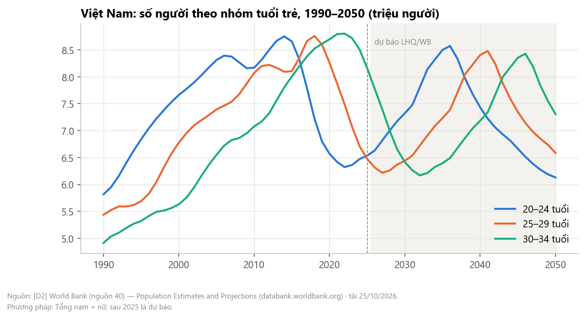
*Nguồn: [D2] World Bank Population Estimates & Projections (nguồn 40), tổng nam + nữ; sau 2025 là dự báo.*

| Số người 20–29 tuổi, triệu [D2] | 2015 | 2020 | 2025 | 2030 | 2035 | 2040 | 2050 |
|---|---|---|---|---|---|---|---|
| Việt Nam | 16,76 | 14,83 | **13,01** | 13,76 | 15,73 | 15,84 | 12,71 |

- Đáy rơi vào năm **2026: 12,94 triệu** [D2]. Nhóm 20–29 chiếm 12,8% dân số năm 2025 (tính từ [D2]: chia cho SP.POP.TOTL nguồn 40).
- 18–34 tuổi: 24,2 triệu (2025) [D2]. 18–29 tuổi ≈ 16,0 triệu (20–29 tuổi + 2/5 nhóm 15–19, tính từ [D2]).
- Ước tính 16,8 triệu (mức D) trong tệp S trước đây cao hơn khoảng 5%.

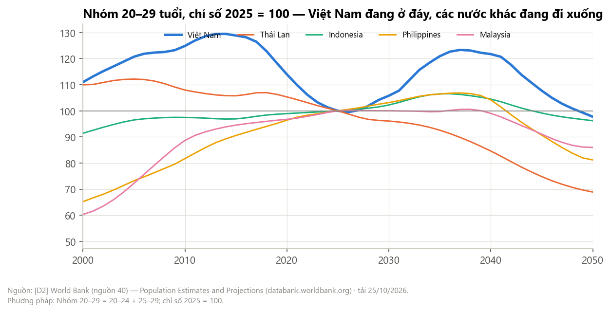
*Nguồn: [D2]. Nhóm 20–29 = 20–24 + 25–29; chỉ số 2025 = 100.*

**So với khu vực, 2025→2035** [D2]: Việt Nam +20,9% · Indonesia +6,5% · Philippines +6,4% · Malaysia −0,3% · Thái Lan −7,4%.

**→ Rút ra:** lớp tân sinh viên từ nay tới khoảng 2033 lớn hơn lớp vừa ra trường [D2]. Kênh tiếp cận qua trường đại học sẽ ngày càng rẻ hơn tính trên mỗi người dùng (suy luận).

### A2. Sức mua: thu nhập chiếm phần lớn mức tăng

> **Chuỗi truy vết:** [D1] `wb_NE.CON.PRVT.PC.KD.json`, `wb_NY.GDP.PCAP.PP.KD.json` + [D2] `wbpop_*` + [D3] `imf_NGDP_RPCH.json` → `analyze_macro.py::purchasing_power` → `summary.json › a2_purchasing_power`

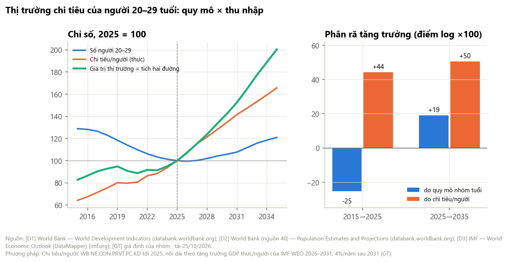
*Nguồn: [D1] NE.CON.PRVT.PC.KD; [D2]; [D3] NGDP_RPCH 2026–2031; [GT] 4%/năm sau 2031.*

- Chi tiêu hộ/người (thực, USD 2015): 1.529 (2015) → 2.382 (2025) [D1] → khoảng 3.947 (2035). Phần 2026–2031 nối dài theo tăng trưởng GDP thực [D3] trừ tăng dân số [D2]; sau 2031 là [GT].
- **2015→2025:** giá trị thị trường 20–29 +21% (quy mô −25 điểm log, thu nhập +44).
- **2025→2035:** khoảng **+100%** (quy mô +19, thu nhập +51). Đều tính từ [D1][D2][D3].
- IMF dự báo tăng trưởng GDP thực của Việt Nam: 8,4% (2026), 7,5% (2027), 5,7–5,9% (2028–2031); lạm phát 4,2–4,9% [D3].

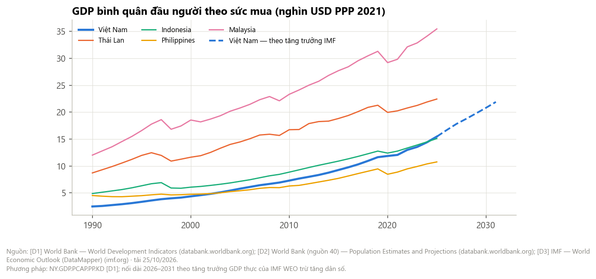
*Nguồn: [D1] NY.GDP.PCAP.PP.KD; nối dài theo [D3] và [D2].*

**Nước tương tự:** GDP/người PPP của Việt Nam năm 2025 (15.457 USD) [D1] bằng **Thái Lan năm 2009** (15.668 USD) [D1]. Năm 2030 (khoảng 20.800 USD, tính từ [D3]) bằng Thái Lan năm 2022 [D1].

**→ Rút ra:** tăng trưởng 10 năm tới đến chủ yếu từ chi tiêu mỗi người. Mô hình doanh thu nên ăn theo giao dịch (hoa hồng đối tác) hơn là theo số đầu người (suy luận).

### A3. Khả năng chi trả và đường cầu

> **Chuỗi truy vết:** [S2][S3][S4][S5] (nhập tay) + [D8] `osrm_destinations.json` + [GT] `ASSUME` → `analyze_market.py::affordability` → `results/a3_affordability.csv`

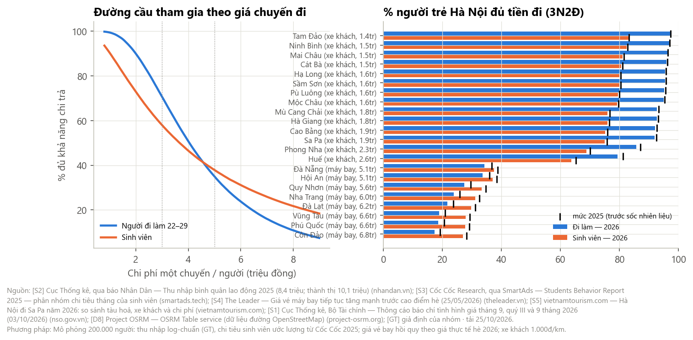
*Nguồn: [S2] thu nhập; [S3] chi tiêu sinh viên; [S4] giá vé bay; [S5] giá xe khách; [S1] truyền dẫn giá; [D8] khoảng cách, giờ xe; [GT] các giả định trong `ASSUME`.*

**Tham số và nguồn:**

| Tham số | Giá trị | Nguồn |
|---|---|---|
| Thu nhập người đi làm 22–29, Hà Nội | log-chuẩn, trung vị 9 tr, σ = 0,55 | [GT], hiệu chỉnh theo [S2] (8,4 tr cả nước; 10,1 tr thành thị) |
| Chi tiêu sinh viên | log-chuẩn, trung vị 2,44 tr, σ = 1,0 (khớp 4 nhóm, sai số 0,002) | **ước lượng từ [S3]** |
| Vé bay khứ hồi | 2,38 tr + 1.853 đ/km | **hồi quy từ 4 giá thực tế [S4]** và km [D8] |
| Xe khách | 1.000 đ/km | [S5] |
| Ở, ăn, giá trị thời gian, giờ xe tối đa | 175 nghìn/đêm; 300 nghìn/ngày; 25 nghìn/giờ; 12 giờ | [GT] |

| Nhóm điểm đến (tính từ mô hình) | Chi phí | % đi làm đủ tiền | % sinh viên đủ tiền |
|---|---|---|---|
| Đi bằng xe khách (14 điểm) | 1,4–2,6 triệu | **94,7%** | **79,0%** |
| Phải bay (8 điểm) | 5,1–6,8 triệu | **36,1%** | **38,4%** |

**Độ co giãn tham gia theo giá chuyến** (tính từ mô hình):

| | 2 tr | 3 tr | 4 tr | 5 tr | 6 tr |
|---|---|---|---|---|---|
| Đi làm | −0,35 | −0,88 | −1,43 | −1,93 | −2,32 |
| Sinh viên | −0,46 | −0,67 | −0,86 | −0,99 | −1,14 |

**→ Rút ra:**
1. Trên ~3,5 triệu/chuyến cầu co giãn mạnh, nên ưu đãi đối tác có giá trị nhất ở các chuyến 4–6 triệu.
2. Cú sốc nhiên liệu 2026 chỉ làm tỉ lệ đủ tiền đi các điểm phải bay giảm thêm khoảng 2 điểm %, vì truyền dẫn chỉ 0,12 (A10, từ [D5][S1]).
3. Kết quả nhạy với [GT] và [S3] (mức C). Phải kiểm lại bằng khảo sát sơ cấp.

> Thử trong dashboard ②.

### A4. Xu hướng hay mốt — 21 từ khoá, 10 năm

> **Chuỗi truy vết:** [D9] `data/raw/trends_{behaviour,motive,planning,transport,booking}.csv` → `data/processed/trends_long.csv` → `analyze_trends.py::keyword_trends` → `results/a4_keyword_classification.csv`

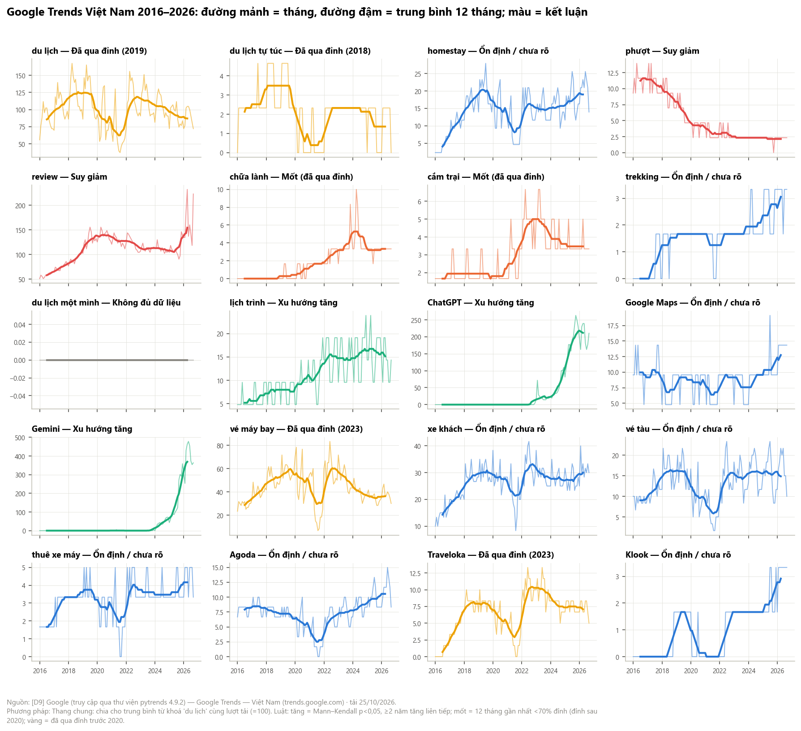
*Nguồn: [D9] Google Trends, geo = VN, 1/2016–9/2026. Thang chung: từ "du lịch" = 100.*

| Kết luận (tính từ [D9]) | Từ khoá | Bằng chứng |
|---|---|---|
| **Xu hướng tăng** | lịch trình | +105% từ 2019; Mann–Kendall τ = 0,90, p = 0,003 |
| | ChatGPT · Gemini | +668% từ 2023 · +284% từ 2024 (p < 0,02) |
| **Mốt (đã qua đỉnh)** | chữa lành | xuất hiện ~2020, đỉnh 8/2024, nay 63% đỉnh |
| | cắm trại | đỉnh 3/2023, nay 69% |
| **Suy giảm** | phượt | −67% từ 2019, τ = −0,88, p = 0,006 |
| | review | −14%, p = 0,01 (bật lại năm 2026) |
| **Đã qua đỉnh từ lâu** | du lịch tự túc (2018), du lịch (2019), vé máy bay (2023), Traveloka (2023) | — |
| **Ổn định / chưa rõ** | homestay, trekking, xe khách, vé tàu, thuê xe máy, Google Maps, Agoda, Klook | — |
| **Không đủ dữ liệu** | du lịch một mình | gần như 0 lượt tìm |

*Đọc cho đúng:* "du lịch tự túc" giảm **không** có nghĩa hành vi tự túc giảm. Có thể tự túc đã thành mặc định nên không cần gõ cụm này (suy luận, cần khảo sát).

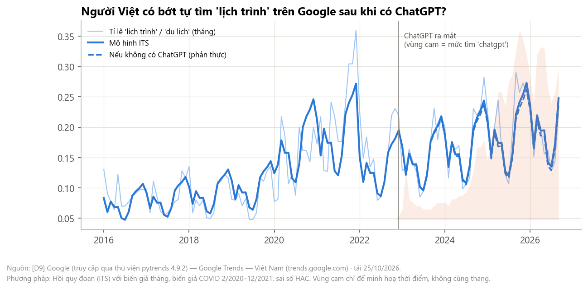
*Nguồn: [D9], nhóm "planning" (du lịch, lịch trình, ChatGPT, Google Maps, Gemini) — cùng một lượt tải.*

**ChatGPT có làm người Việt bớt tra lịch trình?** Không. Mô hình ITS (R² = 0,80) không thấy thay đổi mức (p = 0,99) hay độ dốc (p = 0,65) sau 12/2022; năm 2026 chỉ lệch −2% so với kịch bản không có ChatGPT (tính từ [D9]). Kết quả khớp với khảo sát: 81% định dùng AI nhưng chỉ 28% tin AI [S9].

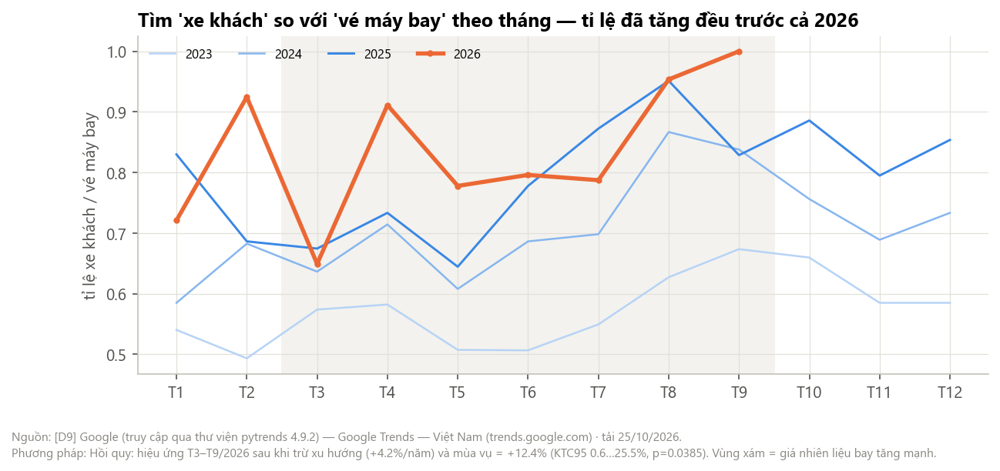
*Nguồn: [D9], nhóm "transport" (du lịch, vé máy bay, xe khách, vé tàu, thuê xe máy) — cùng một lượt tải.*

| Hồi quy 2017–2026, bỏ COVID (tính từ [D9]) | Xu hướng dài hạn | Riêng cú sốc T3–T9/2026 | So cùng tháng 2025 |
|---|---|---|---|
| xe khách / vé máy bay | **+4,2%/năm** | +12,4% (KTC 95%: 0,6–25,5%; p = 0,04) | +7,1% (khác biệt kép: −1,0%) |
| vé tàu / vé máy bay | +3,4%/năm | +15,1% (p = 0,26) | −10,7% |

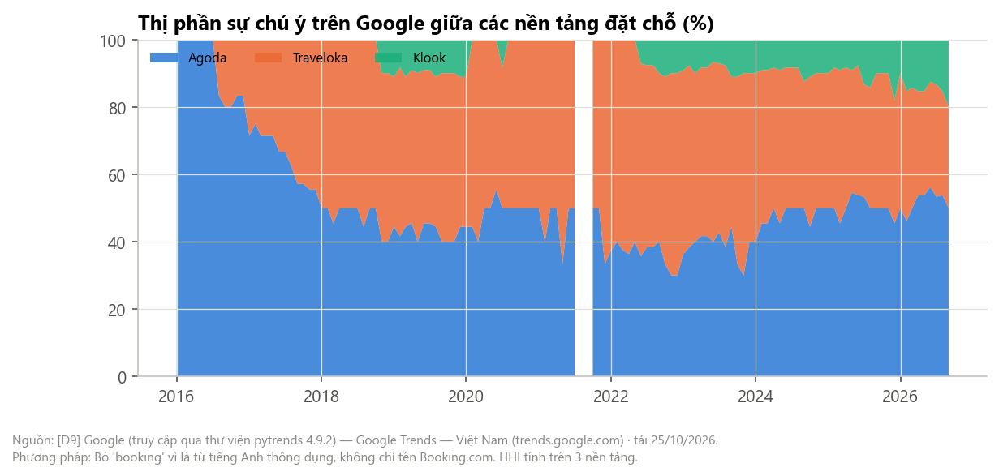
*Nguồn: [D9], nhóm "booking". Bỏ từ "booking" vì là từ tiếng Anh thông dụng.*

**Nền tảng đặt chỗ** (thị phần sự chú ý, tính từ [D9]): Agoda 43% → **50%**, Traveloka 47% → **39%**, Klook 10% → 11% (2019 → 2025). HHI ≈ 4.200.

### A5. Mùa vụ và tăng trưởng 22 điểm đến

> **Chuỗi truy vết:** [D9] `trends_dest{0..5}.csv` (neo "Đà Lạt") + [D10] `pv_*.json` → `analyze_trends.py::destinations` → `results/a5_destinations.csv`, `a5_seasonal_index_trends.csv`

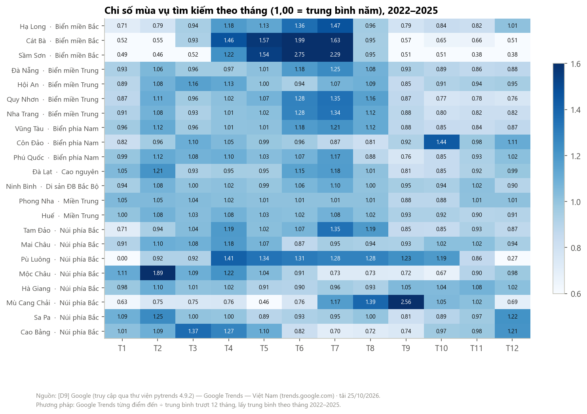
*Nguồn: [D9]. Chỉ số = giá trị tháng ÷ trung bình trượt 12 tháng, trung bình 2022–2025.*

- **Dồn mùa nhất** (Gini mùa vụ, tính từ [D9]): Sầm Sơn 0,39 (đỉnh T6), Cát Bà 0,27, Mù Cang Chải 0,25 (đỉnh T9), Pù Luông 0,22.
- **Đều nhất:** Phong Nha 0,02, Ninh Bình 0,03, Hà Giang 0,04, Huế 0,04.

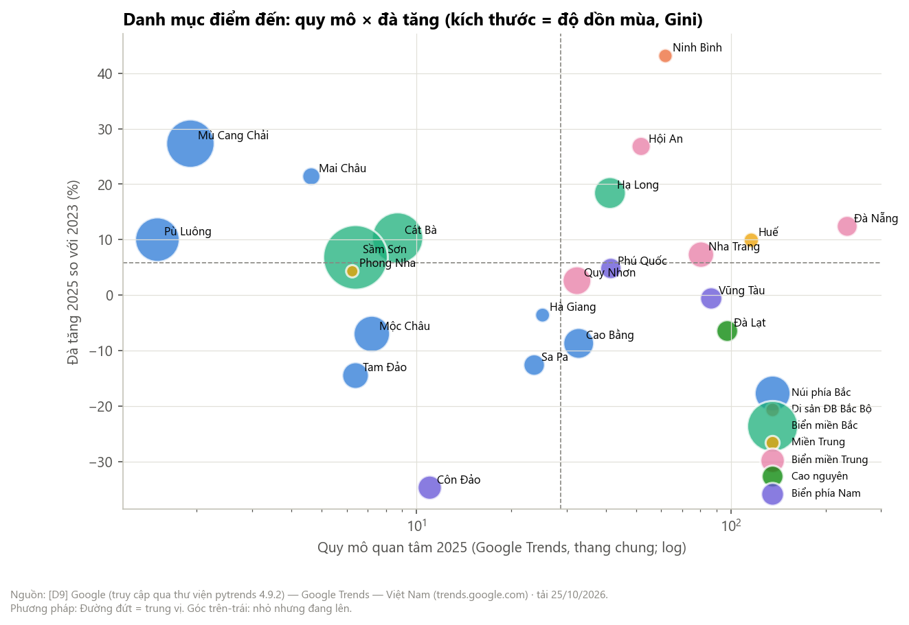
*Nguồn: [D9]. Đường đứt = trung vị.*

| Đà tăng quan tâm 2025 so với 2023 (tính từ [D9]) | Điểm đến |
|---|---|
| > +20% | **Ninh Bình +43%**, Mù Cang Chải +27%, Hội An +27%, Mai Châu +21% |
| +10–20% | Hạ Long +18%, Đà Nẵng +12%, Cát Bà, Pù Luông, Huế +10% |
| Giảm | **Côn Đảo −35%**, Tam Đảo −15%, **Sa Pa −13%**, Cao Bằng −9%, Mộc Châu −7%, Đà Lạt −6% |

**→ Rút ra:** điểm đang lên là điểm gần, nhỏ, có cảnh quan. Điều này khớp với khảo sát "49% Gen Z chọn điểm ít người biết" [S8].

*Lưu ý:* mùa vụ trên Wikipedia [D10] lệch so với Google Trends ở các thành phố lớn (tương quan âm ở Hạ Long, Đà Nẵng, Huế) vì mang mùa học đường. Vì vậy chỉ dùng [D9] để đo mùa du lịch.

### A6. Khí hậu, rủi ro và cửa sổ lệch mùa

> **Chuỗi truy vết:** [D11] `meteo_*.json` (22 điểm × 7.670 ngày) → `climate_daily.csv.gz` → `analyze_space.py::climate, offseason_gap` → `results/a6_climate_monthly.csv`, `a6_extreme_rain_trend.csv`, `a6_north_pooled.json`, `a6_offseason_gap.csv`

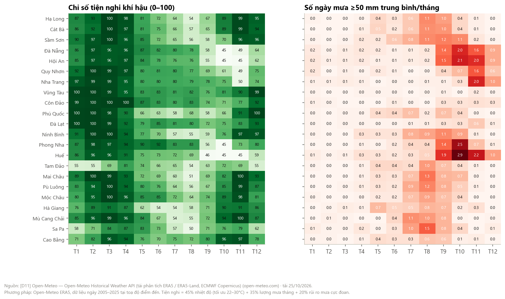
*Nguồn: [D11] Open-Meteo, tái phân tích ERA5/ERA5-Land, dữ liệu ngày 2005–2025. Công thức tiện nghi là [GT].*

- Miền Trung nhiều mưa cực đoan nhất: Huế 9,9 ngày ≥50 mm/năm, dồn T9–T11; riêng T10 là 2,9 ngày [D11].
- **Kiểm định gộp 12 điểm miền Bắc** (tính từ [D11]): +15,9 ngày/thập kỷ (τ = 0,38, p = 0,017). Trung bình 2005–09 là 35,6 ngày; 2021–25 là 52,4 ngày. Tam Đảo có ý nghĩa riêng (p = 0,006).

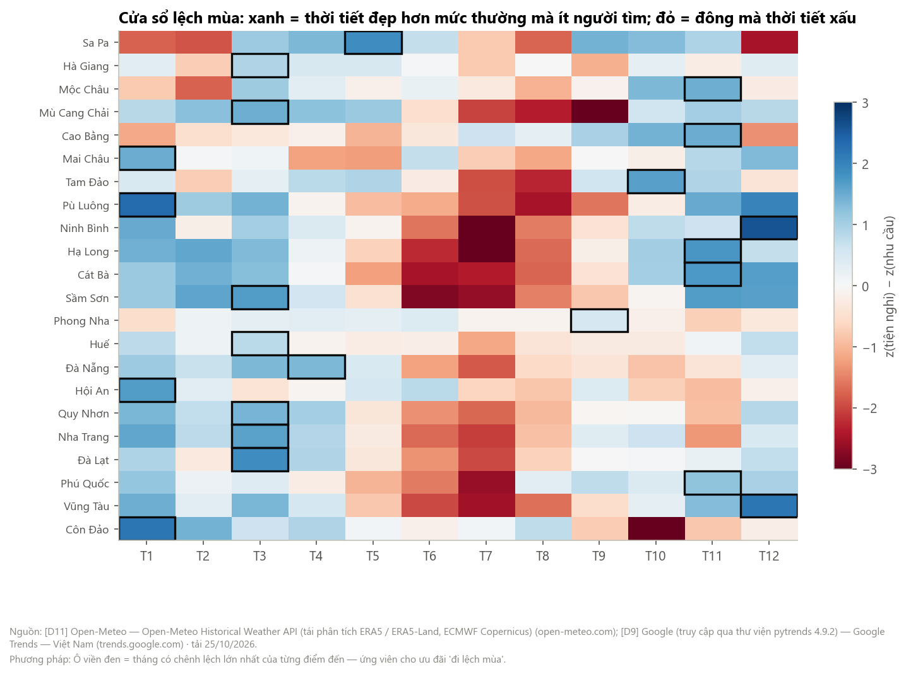
*Nguồn: [D11] (khí hậu) và [D9] (nhu cầu tìm kiếm). Ô viền đen = tháng có chênh lệch lớn nhất.*

| Điểm đến | Tháng lệch mùa tốt nhất | Tiện nghi [D11] | Chỉ số nhu cầu [D9] | Đỉnh nhu cầu [D9] |
|---|---|---|---|---|
| Ninh Bình | **T12** | 97 | 0,90 | T7 |
| Côn Đảo · Vũng Tàu | T1 · T12 | 99 | 0,82 · 0,87 | T10 · T7 |
| Đà Lạt | T3 | 99 | 0,93 | T2 |
| Sa Pa | **T5** | 83 | 0,89 | T2 |
| Hạ Long · Cát Bà | **T11** | 99 | 0,82 · 0,66 | T7 · T6 |
| Sầm Sơn | T3 | 100 | 0,52 | T6 |
| Mộc Châu · Cao Bằng | **T11** | 98 · 97 | 0,90 · 0,98 | T2 · T3 |
| Mù Cang Chải | T3 | 99 | 0,75 | T9 |

**→ Rút ra:** làm "con dấu lệch mùa" theo các cửa sổ này. Tránh chạy chiến dịch núi phía Bắc vào T7–T8 và miền Trung vào T10–T11.

### A7. Mô hình trọng lực và bản đồ thị trường (Huff)

> **Chuỗi truy vết:** [D9] `trendsreg_*.csv` (22 điểm × 63 tỉnh = 1.386 cặp) + toạ độ [D6] `wikicoords_*.json` / [D7] `geocode_*.json` / nhập tay → `analyze_space.py::gravity` → `results/a7_gravity_huff.csv`

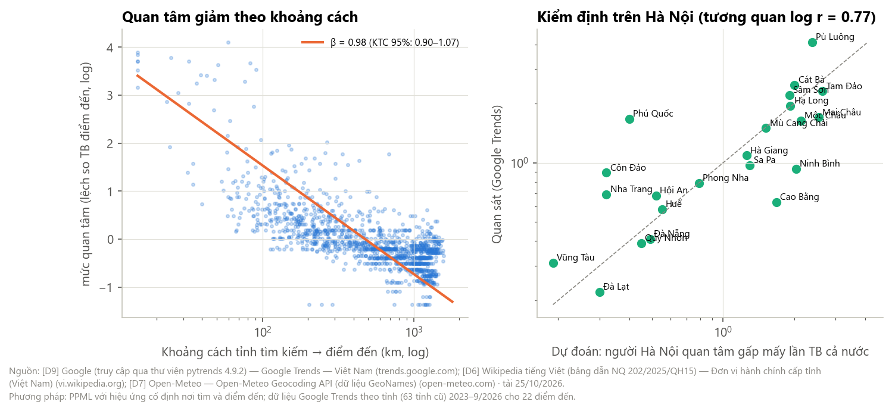
*Nguồn: [D9] Google Trends theo tỉnh, 1/2023–9/2026; toạ độ [D6], [D7].*

- PPML với hiệu ứng cố định nơi tìm và điểm đến (tính từ [D9][D6][D7]): **β = 0,98** (KTC 95%: 0,90–1,07), pseudo-R² = 0,80.
- Sức hút = mức quan tâm toàn quốc [D9] ÷ khả năng tiếp cận trung bình từ 63 tỉnh. Kiểm định trên Hà Nội: r = 0,77.

| Thị phần dự đoán từ Hà Nội, cả năm (tính từ mô hình) | % |
|---|---|
| Ninh Bình | 17,5 |
| Đà Nẵng | 16,0 |
| Hạ Long | 11,0 |
| Huế | 8,9 |
| Cao Bằng | 7,6 |
| Hà Giang · Sa Pa · Đà Lạt · Hội An | 4,4 · 4,3 · 4,0 · 3,8 |

| Ngoại lệ ở Hà Nội | Quan sát [D9] ÷ dự đoán | Diễn giải (suy luận) |
|---|---|---|
| Phú Quốc | 1,67 ÷ 0,40 = **4,2×** | Đường bay thẳng: "khoảng cách" thật là giá vé, không phải km |
| Nha Trang · Côn Đảo | 2,2× · 2,8× | Như trên |
| Pù Luông | 4,10 ÷ 2,39 = **1,7×** | Điểm ưa thích riêng của người Hà Nội |
| Ninh Bình | 0,93 ÷ 2,04 = **0,46×** | Quá gần: đi trong ngày, không cần tìm |
| Cao Bằng | 0,38× | Quan tâm từ nơi khác nhiều hơn từ Hà Nội |

### A8. Cung (lưu trú) so với cầu (sự chú ý)

> **Chuỗi truy vết:** [D12] `osm_*.json` + [D10] `pv_*.json` → `analyze_space.py::supply` → `results/a8_supply_demand.csv`

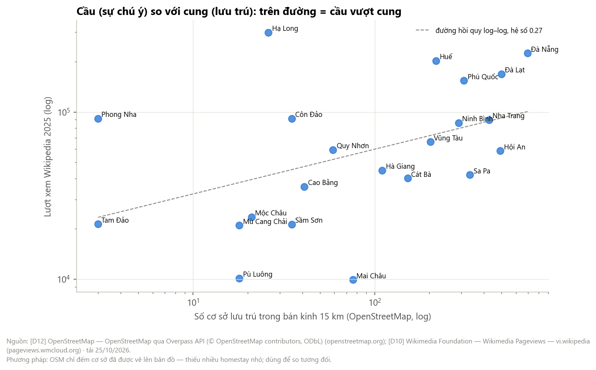
*Nguồn: [D12] OpenStreetMap/Overpass (bán kính 15 km, 10/2026); [D10] lượt xem Wikipedia 2025.*

- Hệ số co giãn sự chú ý theo số cơ sở lưu trú là **0,27** (tính từ [D12][D10]).
- **Cầu vượt cung:** Hạ Long +1,97, Phong Nha +1,36, Huế +1,01, Côn Đảo, Phú Quốc, Đà Lạt.
- **Cung vượt cầu:** Mai Châu −1,73, Pù Luông −1,32, Sầm Sơn, Sa Pa −0,68, Mù Cang Chải, Mộc Châu, Cát Bà.
- *Hạn chế của [D12]:* thiếu nhiều homestay nhỏ.

**→ Rút ra:** ở Mai Châu, Pù Luông, Mộc Châu, Sa Pa, đối tác có động lực trả tiền để có khách (suy luận).

### A9. Android và iOS

> **Chuỗi truy vết:** [D4] `statcounter_os_mobile.csv`, `statcounter_vendor_mobile.csv` → `analyze_macro.py::mobile_os` → `summary.json › a9_mobile_os`

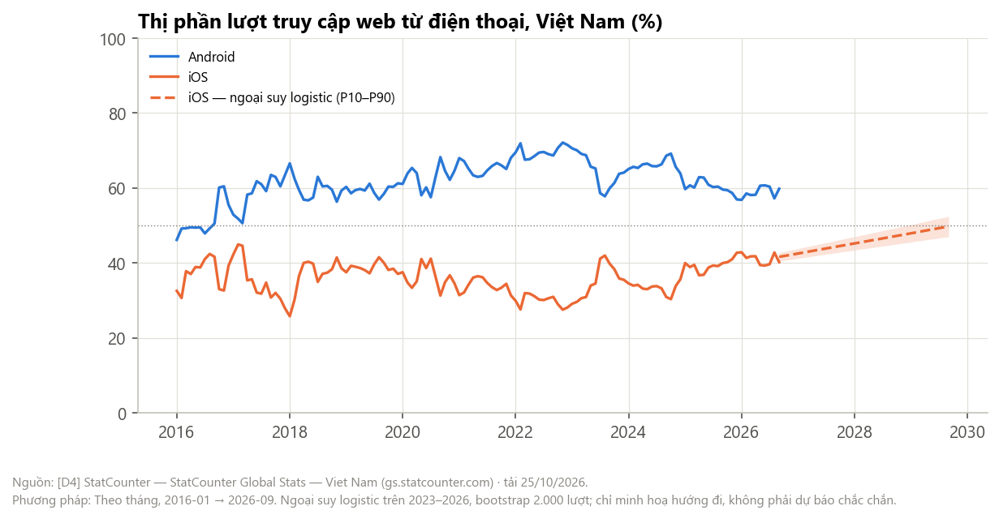
*Nguồn: [D4] StatCounter Global Stats — "Source: StatCounter Global Stats". Ngoại suy logistic 2023–2026, bootstrap.*

- iOS **40,2%** (9/2026). Trung bình năm: 29,9% (2022) → 35,1% (2023) → 39,4% (2025) → 41,0% (2026) [D4].
- Mann–Kendall 2022–2026: τ = 0,59, p ≈ 10⁻¹⁰. Ngoại suy 9/2029: khoảng 50% (P10–P90: 47–52%) (tính từ [D4]).
- Theo hãng (lượt truy cập): Apple 40%, Samsung 20%, Oppo 15%, Xiaomi 12% [D4]. Đối chiếu: Apple chỉ chiếm 20% máy bán ra quý IV/2025 [S10].

### A10. Cú sốc nhiên liệu 2026

> **Chuỗi truy vết:** [D5] `fred_DJFUELUSGULF.csv`, `fred_DCOILBRENTEU.csv` + [S1] → `analyze_macro.py::fuel_shock` → `summary.json › a10_fuel`

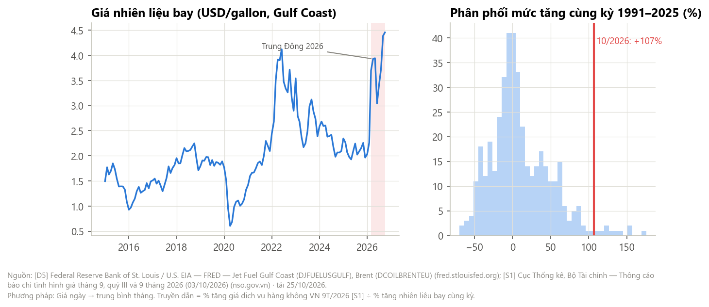
*Nguồn: [D5] FRED (gốc: U.S. EIA); [S1] Cục Thống kê.*

- Nhiên liệu bay: **4,46 USD/gallon** (10/2026, trung bình các ngày đã có), **+107%** so cùng kỳ; điểm z = 2,46; phân vị 97,2 so với 1991–2025 [D5].
- Trung bình 9 tháng 2026 so với 2025: **+59,8%** [D5].
- Giá dịch vụ hàng không Việt Nam +7,34% [S1] → **hệ số truyền dẫn ≈ 0,12** (tính từ [D5][S1]).
- Brent 125 USD/thùng [D5].

### A11. Quy mô thị trường — Monte Carlo

> **Chuỗi truy vết:** dân Hà Nội [D6] + tỉ lệ 20–29 [D2] + [S6][S7][S8] + [GT] → `analyze_market.py::market_size` → `summary.json › a11_market`

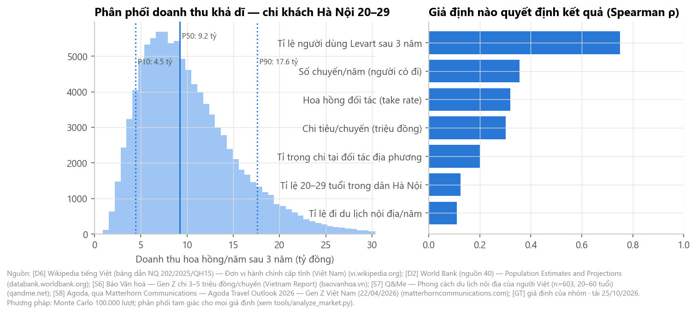
*Nguồn: [D6] dân số Hà Nội theo NQ 202/2025; [D2]; [S6]; [S7]; [S8]; [GT] các phân phối tam giác.*

| Giả định (phân phối tam giác: thấp / khả dĩ nhất / cao) | Giá trị | Nguồn |
|---|---|---|
| Dân Hà Nội | 8.807.523 | [D6] |
| Tỉ lệ 20–29 trong dân Hà Nội | 12,8% / 15% / 18% | sàn = tỉ lệ cả nước [D2]; còn lại [GT] |
| Tỉ lệ đi du lịch nội địa/năm | 65% / 78% / 88% | quanh 80% của [S7] |
| Số chuyến/năm | 1,5 / 2,5 / 4 | [S8] ("tới 6 chuyến") + [GT] |
| Chi tiêu/chuyến | 2,5 / 3,5 / 5,5 triệu | quanh 3–5 tr của [S6] |
| Tỉ trọng chi tại đối tác; tỉ lệ dùng Levart; hoa hồng | 35–60%; 0,5–5%; 5–12% | [GT] |

| Tầng (tỷ đồng/năm, tính từ mô hình) | P10 | **P50** | P90 |
|---|---|---|---|
| TAM — tổng chi du lịch nội địa | 7.156 | **10.256** | 14.497 |
| SAM — chi tại đối tác địa phương | 3.227 | **4.759** | 6.894 |
| SOM — GMV qua Levart sau 3 năm | 56 | **113** | 206 |
| Doanh thu hoa hồng | 4,5 | **9,2** | 17,6 |

**Độ nhạy** (Spearman ρ với doanh thu): tỉ lệ dùng Levart **0,75** [GT] · số chuyến 0,36 · hoa hồng 0,32 [GT] · chi tiêu/chuyến 0,30 · còn lại ≤ 0,20.

**→ Rút ra:** giả định quyết định nhất lại là giả định **không có nguồn** [GT]. Đây phải là con số đo đầu tiên trong thử nghiệm.

### A12. Chọn điểm đến thí điểm (QĐ3) — MCDA

> **Chuỗi truy vết:** `a5_destinations.csv` [D9][D10] + `a3_affordability.csv` [S3][D8] + `a6_climate_monthly.csv`, `a6_extreme_rain_trend.csv` [D11] + `a8_supply_demand.csv` [D12][D10] → `analyze_space.py::mcda` → `results/a12_mcda.csv`

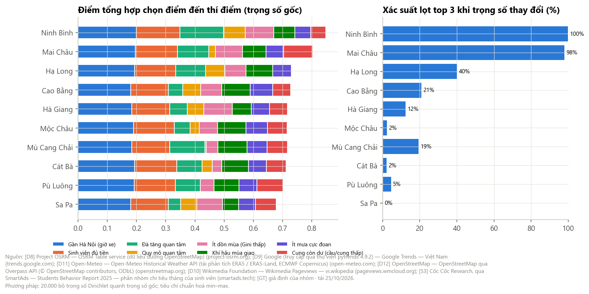
*Nguồn: [D8] giờ xe; [S3] + mô hình A3 (sinh viên đủ tiền); [D9] quy mô, đà tăng, dồn mùa; [D11] khí hậu, mưa cực đoan; [D12][D10] cung–cầu; [GT] trọng số.*

| Tiêu chí | Đo bằng | Nguồn | Trọng số gốc [GT] |
|---|---|---|---|
| Gần Hà Nội | giờ lái xe | [D8] | 20% |
| Sinh viên đủ tiền | % (A3) | [S3][S4][S5][D8] | 15% |
| Đà tăng quan tâm | 2025 so với 2023 | [D9] | 15% |
| Quy mô quan tâm | mức 2025 (log) | [D9] | 10% |
| Ít dồn mùa | Gini mùa vụ | [D9] | 10% |
| Khí hậu mùa giao | tiện nghi T3–5, T9–11 | [D11] | 10% |
| Ít mưa cực đoan | ngày ≥50 mm/năm | [D11] | 10% |
| Cung còn dư | phần dư cầu/cung | [D12][D10] | 10% |

| Hạng | Điểm đến | Điểm | P(lọt top 3), 20.000 bộ trọng số | Hạng trung vị |
|---|---|---|---|---|
| 1 | **Ninh Bình** | 0,85 | **99,8%** | 1 |
| 2 | **Mai Châu** | 0,80 | **98,0%** | 2 |
| 3 | Hạ Long | 0,73 | 40,2% | 4 |
| 4 | Cao Bằng | 0,73 | 20,9% | 5 |
| 5 | Hà Giang | 0,72 | 12,3% | 6 |
| 6 | Mù Cang Chải | 0,72 | 19,3% | 6 |
| 7 | Mộc Châu | 0,72 | 2,4% | 6 |
| 10 | Sa Pa | 0,68 | 0% | 10 |

**→ Rút ra cho QĐ3:** Ninh Bình + Mai Châu là cặp thí điểm vững nhất; thêm Mù Cang Chải hoặc Hà Giang làm điểm "núi xa". Không chọn Sa Pa.

---

## PHẦN D – DỰ BÁO

| Biến | 2025 | 2030 | 2035 | Nguồn |
|---|---|---|---|---|
| Số người 20–29 tuổi | 13,0 tr | 13,8 tr | 15,7 tr | [D2] (dự báo của WB) |
| Chi tiêu hộ/người, USD 2015 | 2.382 | ~3.200 | ~3.950 | [D1]; 2026–31 theo [D3]; sau 2031 [GT] |
| Giá trị thị trường 20–29 (chỉ số) | 100 | ~143 | ~200 | tính từ [D1][D2][D3][GT] |
| GDP/người PPP ≈ Thái Lan năm | 2009 | 2022 | — | tính từ [D1][D3] |
| iOS (% lượt web) | 39,4 | ~50 (2029) | — | ngoại suy từ [D4] |
| Ngày mưa cực đoan, 12 điểm miền Bắc | ~52/năm | +16/thập kỷ nếu xu hướng giữ | — | tính từ [D11] |
| Tìm xe khách / vé máy bay | — | +4,2%/năm | — | tính từ [D9] |

---

## PHẦN E – HẠN CHẾ THEO TỪNG NGUỒN

| Nguồn | Hạn chế | Ảnh hưởng tới |
|---|---|---|
| [D9] Google Trends | Chỉ số tương đối 0–100, làm tròn số nguyên, không phải số người. Theo tỉnh, mỗi từ khoá chuẩn hoá riêng. Tên trùng tỉnh (Hà Giang, Cao Bằng, Ninh Bình, Huế) lẫn tìm tin tức | A4, A5, A7 |
| [D10] Wikipedia | Mang mùa vụ học đường | A5 (chỉ để đối chiếu), A8 |
| [D12] OpenStreetMap | Thiếu homestay nhỏ, nhất là vùng núi | A8, A12 |
| [D4] StatCounter | Đo lượt truy cập web, không đo số máy | A9 |
| [D6][D7] toạ độ | Toạ độ bài viết, có 8 điểm nhập tay | A7 |
| [S3]–[S6] | Báo chí, mức C; [S7] đã cũ | A3, A11 |
| [GT] | Không có nguồn | A3, A11, A12 |
| Mô hình Huff | Dùng khoảng cách chim bay, đánh giá thấp điểm có đường bay thẳng | A7 |
| Chưa có | Số khách theo tỉnh, theo tháng của Cục Du lịch Quốc gia ở dạng tải được | mùa vụ |

---

## PHẦN F – CÁCH CHẠY LẠI VÀ KIỂM TRA NGUỒN

```bash
cd data_inspect/tools
pip install pandas numpy scipy statsmodels matplotlib plotly requests pytrends
python run_all.py            # dùng dữ liệu đã có trong data/raw (cache)
python run_all.py --fetch    # tải lại nguồn còn thiếu (xoá tệp trong data/raw để tải mới)
python sources.py            # cập nhật _MANIFEST.csv (mã băm, thời điểm tải) và SOURCES.md
```

- **Kiểm một con số:** tìm mục chứa con số → đọc dòng *Chuỗi truy vết* → mở tệp kết quả trong `results/` → mở tệp gốc trong `data/raw/` → tra `_MANIFEST.csv` để lấy URL và so mã băm.
- Google Trends giới hạn tần suất: gặp lỗi 429 thì đợi 15–30 phút.
- Bản quyền: World Bank, IMF, Open-Meteo: CC BY 4.0 · Wikipedia: CC BY-SA 4.0 · OpenStreetMap: ODbL · StatCounter: ghi "Source: StatCounter Global Stats" · ERA5 © ECMWF/Copernicus.

---

## PHẦN G – CẬP NHẬT CHO 7 TỆP R1

| Tệp R1 | Nhận định cũ | Dữ liệu nói gì | Nguồn mới | Đổi mức |
|---|---|---|---|---|
| Xu hướng | "Chữa lành là động cơ thật" | Từ khoá "chữa lành" là mốt đã qua đỉnh (8/2024) | [D9] | C → B |
| Xu hướng | "AI bổ sung, chưa thay thế" | ITS: không tác động lên tìm "lịch trình" (p = 0,99) | [D9] | C → B |
| Xu hướng | "Đi một mình là ngách" | "du lịch một mình" gần như không ai tìm | [D9] | C → B |
| E | "Ưu tiên lộ trình xe khách" | Xe khách: 95% đủ tiền; máy bay: 36%; xu hướng sang xe khách +4,2%/năm | [S2]–[S5][D8][D9] | D → B |
| S | "18–29 tuổi ≈ 16,8 triệu (D)" | 18–29 ≈ 16,0 triệu; 20–29 = 13,0 triệu; đáy năm 2026 | [D2] | D → A |
| S | Bảng nhiệt mùa vụ | Thay bằng chỉ số mùa vụ đo được và khí hậu thật | [D9][D11] | C → A/B |
| T | "iOS ~40%" | 40,2%, tăng có ý nghĩa, ~50% năm 2029 | [D4] | B |
| Môi trường | "Mưa lũ núi phía Bắc T6–T9" | Đúng, và tăng +16 ngày mưa cực đoan/thập kỷ | [D11] | C → A |
