# LEVART — NGÀNH VÀ 5 LỰC CẠNH TRANH ĐO BẰNG DỮ LIỆU
### Quy mô ngành → cạnh tranh → gia nhập → người dùng → nhà cung cấp → thay thế → điều Levart nên làm

*Soạn 26–27/10/2026 · Dữ liệu tải 26/10/2026 (OSM bổ sung 27/10) · Bản 0.2 · Bổ sung cho bước R2 trong `PLAN_RESEARCH.md` (mục 4) và 7 tệp `01_Nghien-cuu/R2_Nganh_5-luc/*.html`. Cùng cấu trúc với `data_inspect/R1_PESTLE/report.md`.*

**Các tệp đi kèm**

| Tệp | Nội dung |
|---|---|
| `Levart_5Forces_Dashboard.html` | Dashboard tương tác, chạy offline (~5 MB). 6 mô phỏng: bản đồ định vị chọn trục bất kỳ (2D/3D) và chỉnh vector Levart; HHI khi Levart vào thị trường; khuếch tán Bass có rời bỏ; xác suất bị chấm 1–2 sao theo chủ đề đánh giá; thương lượng Nash về phí với homestay; chỉ số 5 lực với chỉ báo và trọng số tự chỉnh |
| `SOURCES.md` · `data/raw/_MANIFEST.csv` | Bảng nguồn; mỗi tệp gốc kèm yêu cầu chính xác, thời điểm tải, SHA-256 |
| `tools/fetch_data.py` | Tải 7 nguồn [D1–D7] (+ dùng lại kết quả R1 [D8]) |
| `tools/analyze_overview.py` | B1 Tổng quan ngành |
| `tools/analyze_competition.py` | B2 Cạnh tranh hiện tại · B3 Đối thủ mới gia nhập · B6 Sản phẩm thay thế |
| `tools/analyze_buyers.py` | B4 Quyền lực người dùng |
| `tools/analyze_suppliers.py` | B5 Quyền lực nhà cung cấp |
| `tools/analyze_synthesis.py` | B7 Tổng hợp — chỉ số 5 lực |
| `tools/build_dashboard.py`, `tools/run_all.py`, `tools/sources.py` | Dựng dashboard; chạy lại toàn bộ; sổ đăng ký nguồn |
| `results/summary.json`, `results/*.csv`, `results/img/*.png` | Mọi con số, bảng chi tiết, 21 biểu đồ |

> **Cách đọc trích nguồn** (giống R1):
> - **[D1]…[D8]**: dữ liệu công cụ tải thẳng về (tệp gốc trong `data/raw/`).
> - **[S1]…[S9]**: số liệu thứ cấp nhập tay.
> - **[GT]**: giả định của nhóm, không có nguồn.
> - **"tính từ"**: con số do công cụ tính ra.
>
> Mỗi mục có dòng **Chuỗi truy vết** *nguồn → tệp gốc → công cụ → tệp kết quả*. Bảng nguồn đầy đủ ở **Phần B**.

> **Ranh giới ngành dùng xuyên suốt** (PLAN_RESEARCH 4.1): *"ứng dụng hỗ trợ người trẻ đi du lịch nội địa tự túc tại Việt Nam"*. Gồm: (A) app lên kế hoạch, sưu tầm — sân chính; (B) trung gian dịch vụ — nơi kiếm tiền; (C) mạng xã hội — kênh.

---

## PHẦN A – TÓM TẮT CHO NGƯỜI BẬN

1. **Ngành gốc tăng nhanh và đã vượt hẳn trước COVID.**
   - Giá trị tăng thêm thực của ngành dịch vụ lưu trú và ăn uống năm 2025 đạt **128,8% mức 2019**; năm 2021 chỉ còn 67,6%.
   - Nhịp tăng thực 2023–2025 là **9,9%/năm**; 9 tháng 2026 tăng 8,83% [D1].
   - Du lịch trực tuyến ước 3–4 tỷ USD (2025), tăng 8,5–15%/năm [S3][S4].
   - → *Ngành đang lớn nhanh hơn nền kinh tế — điều kiện làm dịu cạnh tranh trực diện.*

2. **Mảng đặt chỗ rất tập trung và thứ hạng gần như không đổi.**
   - Trên App Store Việt Nam, nhóm đặt chỗ có **HHI = 3.178** (trên 2.500 là "rất tập trung"); 3 hãng đầu chiếm **88,8%**: Agoda 47,2%, Booking.com 25,7%, Traveloka 15,9% [D4].
   - Thứ hạng sự chú ý trên Google giữa các năm tương quan **ρ ≈ 0,96** [D6].
   - → *Không chen vào mảng đặt chỗ.*

3. **Ô "hộ chiếu, check-in, cộng đồng" chưa có người Việt chiếm.**
   - Trên bản đồ định vị 12 trục (PCA trên mô tả của 23 đối thủ), 3 app gần vector mục tiêu của Levart nhất là **Swarm (cosine 0,88), Been (0,83), Polarsteps (0,81)** [D2][D4].
   - Cả ba là app nước ngoài, gần như không có người dùng ở Việt Nam: tổng **chưa tới 400 đánh giá** trên App Store Việt Nam (Swarm 34, Polarsteps 91), so với 238.534 của Agoda [D4].

4. **Vào ngành thì dễ, lớn lên thì rất khó.**
   - Phí đăng ký phát hành chỉ 25 USD [S6]; số app du lịch mới trên App Store Việt Nam tăng từ 86 (2022) lên 228 (2025) [D4].
   - Nhưng chỉ **12,6%** app du lịch ra mắt từ 2022 đạt 100.000 lượt cài, **3,7%** đạt 1 triệu.
   - Lượt cài dồn cực độ: **Gini = 0,954**; 1% app lớn nhất giữ **46,8%** tổng lượt cài; luật luỹ thừa với số mũ ≈ 1,9 [D2].
   - Thương hiệu Việt rút lui để lại dấu vết rõ trên Google: Luxstay còn **0%** mức quan tâm đỉnh, Vntrip **13,5%**, Mytour **16,3%** [D6].

5. **Người dùng "trừng phạt" khi dịch vụ hỏng, không phải khi đắt** (15.483 đánh giá [D3][D5]):
   - Nhắc **hoàn tiền, huỷ** → khả năng bị chấm 1–2 sao tăng **×12,6**; **đặt chỗ thất bại** ×17,8; **chăm sóc khách hàng** ×4,9.
   - **Giá, phí** gần như không ảnh hưởng (×1,04, p = 0,7) — hồi quy logistic có hiệu ứng cố định từng app.
   - Các OTA phải trả lời **93–100%** đánh giá; 500 đánh giá gần nhất của Agoda có **71%** là 1–2 sao.
   - → *Với Levart: một lần hỏng ở đối tác (phòng không có, không hoàn tiền) đắt hơn mọi khuyến mãi.*

6. **Nhà cung cấp dịch vụ địa phương yếu thế — Levart có dư địa thương lượng.**
   - Công suất chỗ ở ngắn hạn 45% [S1]; chỉ khoảng **27%** đêm phòng lẽ ra vẫn đến qua OTA.
   - Mô hình thương lượng Nash cho dải phí cả hai cùng có lợi **4,1%–59,8%** giá phòng; nghiệm Nash **20,8%** khi sức thương lượng của Levart β = 0,3, và **9,7%** khi β = 0,1 [S1][S2][GT].
   - OpenStreetMap ở cả 34 tỉnh (11.459 cơ sở): chỉ **2,63%** thuộc chuỗi; chỉ số phân mảnh **0,9999**; chỉ 16,7% có dấu hiệu hiện diện số [D7].
   - Các tỉnh vùng cao phía Bắc độc lập nhất: Tuyên Quang 0% chuỗi và 71% loại nhỏ, Lai Châu 0% và 66% (xem A7).

7. **Sản phẩm thay thế là lực mạnh nhất.**
   - Lượt cài của sản phẩm thay thế (Google Maps, ChatGPT, Gemini, TikTok, Facebook…) gấp **938 lần** các app lên kế hoạch, sưu tầm [D2].
   - Năm 2025 người Việt tìm "chatgpt" nhiều gấp **11,4 lần** "lịch trình"; tìm "tour du lịch" giảm 25,6% so với 2019 [D6].

8. **Chỉ số 5 lực đo từ dữ liệu** (0–4): sản phẩm thay thế **3,65 (Rất cao)** · nhà cung cấp công nghệ **3,0 (Cao)** · cạnh tranh hiện tại **2,80 (Cao)** · người dùng **2,73 (Cao)** · đối thủ mới **2,34 (Trung bình)** · nhà cung cấp địa phương **1,28 (Thấp–trung bình)**. Khớp mức với nhận định tại bàn ở 4/6 lực. Hai chỗ lệch: người dùng thấp hơn tại bàn (2,73 so với 4), đối thủ mới thấp hơn (2,34 so với 3), vì dữ liệu cho thấy rào cản *lớn lên* rất cao.
   - → *Kết luận R2 giữ nguyên:* ngành kém hấp dẫn nếu Levart là "một app du lịch nữa"; hấp dẫn ở đúng một ngách — **bằng chứng đã đi có xác thực + quan hệ đối tác ở tỉnh nhỏ**.

---

## PHẦN B – NGUỒN DỮ LIỆU VÀ PHƯƠNG PHÁP

### B1. Dữ liệu tải trực tiếp (26/10/2026; kê trong `data/raw/_MANIFEST.csv`)

| Mã | Nguồn — tổ chức | Link | Dữ liệu lấy | Phạm vi | Mức |
|---|---|---|---|---|---|
| <a id="D1"></a>**D1** | Báo cáo, thông cáo tình hình kinh tế – xã hội — Cục Thống kê | <https://www.nso.gov.vn/> · API `…/wp-json/wp/v2/posts` | Tốc độ tăng giá trị tăng thêm thực ngành lưu trú và ăn uống; doanh thu lữ hành, lưu trú–ăn uống ở các kỳ có công bố mức | 296 bài, 2017 → 9T/2026 | A |
| <a id="D2"></a>**D2** | Google Play, cửa hàng Việt Nam (qua google-play-scraper 1.2.7) | <https://play.google.com/store/apps?hl=vi&gl=VN> | 671 app (44 từ khoá + 23 đối thủ): lượt cài, điểm, ngày ra mắt, cập nhật, mô tả | 10/2026 | B |
| <a id="D3"></a>**D3** | Google Play — đánh giá tiếng Việt, cửa hàng VN | như trên | 8.579 đánh giá mới nhất (tối đa 500/app) | 23 app | B |
| <a id="D4"></a>**D4** | Apple iTunes Search & Lookup API, country = vn | <https://performance-partners.apple.com/search-api> | 4.499 app: **số đánh giá ở cửa hàng Việt Nam**, ngày ra mắt, cập nhật, mô tả | 10/2026 | B |
| <a id="D5"></a>**D5** | Apple Customer Reviews RSS (Việt Nam) | <https://rss.applemarketingtools.com/> | 6.904 đánh giá gần nhất | 22 app | B |
| <a id="D6"></a>**D6** | Google Trends (qua pytrends 4.9.2) | <https://trends.google.com/trends/explore?geo=VN> | 6 nhóm: OTA toàn cầu, OTA Việt, thương hiệu khác, thay thế, săn giá, loại hình lưu trú | 1/2016–9/2026 | B (tương đối) |
| <a id="D7"></a>**D7** | OpenStreetMap qua Overpass (© OSM contributors, ODbL) | <https://www.openstreetmap.org/> | Ranh giới 34 tỉnh mới; cơ sở lưu trú theo tỉnh, thương hiệu, liên hệ | 10/2026 | B |
| <a id="D8"></a>**D8** | Levart — `data_inspect/R1_PESTLE` | `R1_PESTLE/results/summary.json` | Số người 20–29 ở Hà Nội; độ co giãn chi trả; CPI | — | A/B |

### B2. Số liệu thứ cấp nhập tay

| Mã | Tài liệu | Link | Con số dùng | Mức |
|---|---|---|---|---|
| **S1** | Airbtics — Vietnam STR Market Review 2025 | <https://airbtics.com/short-term-rental-market-report-2025-vietnam> | cung +42,76%, doanh thu +14,52%, công suất 45,33%, giá/đêm ~974.000 đ | C |
| **S2** | Đỗ Công Nguyên — Tạp chí KTTC (12/05/2026) | <https://nghiencuu.tapchikinhtetaichinh.vn/chien-luoc-phan-phoi-kenh-dat-phong-cua-cac-chuoi-khach-san-viet-nam-nghien-cuu-truong-hop-muong-thanh-va-vinpearl-155966.html> | OTA 58,85% lượt đặt; hoa hồng 15–25%; kênh trực tiếp 4,25–4,5% | C |
| **S3** | e-Conomy SEA 2025 (qua PhocusWire) | <https://www.phocuswire.com/vietnam-online-travel-market-double-2030> | 4 tỷ USD (2025) → 8 tỷ USD (2030) | B |
| **S4** | Mordor Intelligence (qua DayTrips Vietnam) | <https://daytripsvietnam.com/research/vietnam-online-travel-market-research/> | 2,87 → 4,69 tỷ USD (2025–2031) | C |
| **S5** | Cục Du lịch Quốc gia | <https://images.vietnamtourism.gov.vn/vn/dmdocuments/2023/ttdl2023.1.12.pdf> | Khách nội địa 85 / 101,3 / 108 / 135,5 triệu (2019 / 22 / 23 / 25) | A |
| **S6** | Google Play — Service fees | <https://support.google.com/googleplay/android-developer/answer/112622> | 15% cho 1 triệu USD đầu | A |
| **S7** | Google Maps Platform — Billing FAQ | <https://developers.google.com/maps/billing-and-pricing/faq> | ngưỡng miễn phí theo SKU từ 01/03/2025 | A |
| **S8** | Decision Lab Travel Rankings 2024 | <https://www.decisionlab.co/blog/vietnam-travel-landscape-2024> | điểm cân nhắc | B |
| **S9** | Klook: đặt chỗ qua creator +246% (2025) | <https://incrussia.ru/news/turisticheskaya-platforma-klook-privlekla-blogerov-k-prodvizheniyu-novyh-napravlenij-vo-vetname/> | — | C |

**[GT]** (không có nguồn): từ điển 12 trục tính năng và vector mục tiêu của Levart (`analyze_competition.FEATURES`, `LEVART`); từ điển chủ đề đánh giá (`analyze_buyers.TOPICS`); danh sách chuỗi khách sạn (`analyze_suppliers.CHAINS`); chi phí biên 25%, chi phí kéo khách 40.000 đ, β = 0,3 (`analyze_suppliers.ASSUME`); luật quy đổi chỉ báo về thang 0–4 (`analyze_synthesis`).

### B3. Phương pháp

| Lực / câu hỏi | Phương pháp | Dữ liệu |
|---|---|---|
| Quy mô, tăng trưởng | Bóc số từ văn bản báo cáo bằng biểu thức chính quy; chỉ số chuỗi (2019 = 100); CAGR; ngoại suy log-tuyến tính | D1, S3–S5 |
| Cạnh tranh — tập trung | Thị phần theo số đánh giá ở cửa hàng VN và lượt cài; HHI, CR3; tương quan hạng Spearman qua các năm | D2, D4, D6 |
| Cạnh tranh — định vị | Ma trận 12 tính năng từ mô tả; PCA; phân cụm k-means (5 nhóm chiến lược); cosine với vector Levart; tỉ lệ khoảng trống | D2, D4 |
| Gia nhập | Số app mới theo năm; tỉ lệ còn cập nhật; Kaplan–Meier (chết = ngừng cập nhật > 2 năm); Lorenz, Gini, rank–size; xác suất đạt ngưỡng lượt cài | D2, D4 |
| Rút lui | Đường quan tâm của thương hiệu Việt so với đỉnh | D6 |
| Người dùng | Từ điển chủ đề; hệ số nâng; logistic P(1–2 sao) có hiệu ứng cố định app, sai số HC1; tỉ lệ phản hồi; nhắc tên đối thủ; Mann–Kendall cho từ khoá săn giá | D3, D5, D6, D8 |
| Nhà cung cấp | Cơ cấu cung theo tỉnh, tỉ lệ thuộc chuỗi, HHI theo đơn vị vận hành; mô hình thương lượng Nash | D7, S1, S2 |
| Thay thế | So quy mô lượt cài, số đánh giá; xu hướng tìm kiếm | D2, D4, D6 |
| Tổng hợp | 20 chỉ báo quy về 0–4 bằng luật công khai; 20.000 bộ trọng số Dirichlet → P10–P90 | tất cả |
| Mô phỏng | Bass (1969) có rời bỏ; HHI khi có người mới; logit; Nash | dashboard |

---

## PHẦN C – KẾT QUẢ TỪNG PHÂN TÍCH

### A1. Tổng quan ngành — quy mô và tốc độ tăng

> **Chuỗi truy vết:** [D1] `data/raw/nso_post_*.json` (296 bài) → `data/processed/nso_reports.jsonl` → `tools/analyze_overview.py` → `results/b1_nso_extracted.csv`, `summary.json › b1_overview`

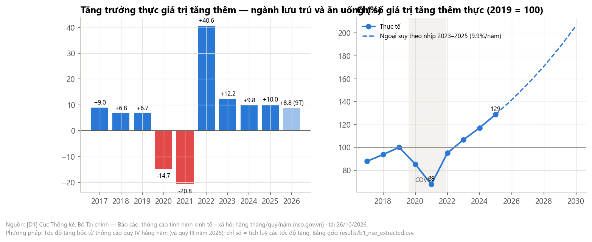
*Nguồn: [D1] Cục Thống kê — thông cáo quý IV hằng năm và quý III/2026.*

| Tăng trưởng thực GTTT ngành lưu trú và ăn uống [D1] | 2017 | 2018 | 2019 | 2020 | 2021 | 2022 | 2023 | 2024 | 2025 | 9T/2026 |
|---|---|---|---|---|---|---|---|---|---|---|
| % so với năm trước | 8,98 | 6,78 | 6,71 | −14,68 | −20,81 | 40,61 | 12,24 | 9,76 | 10,02 | 8,83 |
| Chỉ số (2019 = 100), tính từ [D1] | 87,8 | 93,7 | 100 | 85,3 | 67,6 | 95,0 | 106,6 | 117,0 | **128,8** | — |

- **Phục hồi:** từ 67,6 (2021) lên 128,8 (2025). Tăng bình quân 2019–2025 là 4,3%/năm; riêng 2023–2025 là **9,9%/năm** (tính từ [D1]).
- **Ngoại suy** theo nhịp 2023–2025, chỉ số đạt ~206 năm 2030. Đây là *trần lạc quan*, vì nhịp này còn mang phần bật lại sau COVID [GT].

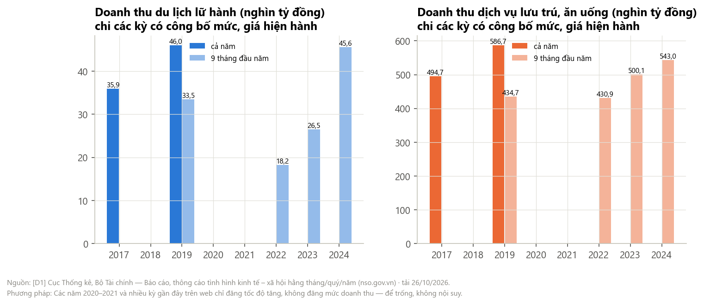
*Nguồn: [D1]. Chỉ các kỳ có công bố mức doanh thu.*

- **Doanh thu du lịch lữ hành** 9 tháng: 33,5 nghìn tỷ (2019) → 18,2 (2022) → 26,5 (2023) → **45,6 (2024)**, tức +36% so với 2019. **Lưu trú–ăn uống** 9 tháng: 434,7 → 430,9 → 500,1 → **543,0**, tức +25% (danh nghĩa) [D1].
- *Hạn chế:* năm 2020–2021 và các kỳ từ 2025 trên web chỉ đăng tốc độ tăng, không đăng mức doanh thu — để trống, không nội suy.

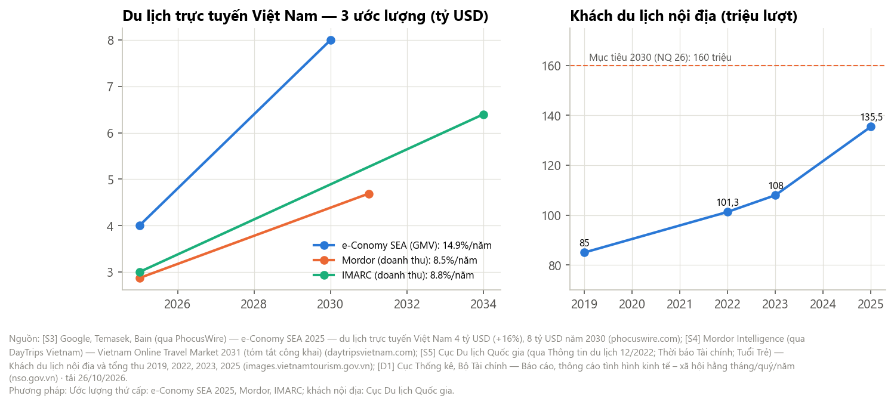
*Nguồn: [S3] e-Conomy SEA; [S4] Mordor; IMARC (qua tệp R2-01); [S5] Cục Du lịch Quốc gia.*

| Ước lượng du lịch trực tuyến | 2025 | Dự báo | Tăng/năm (tính từ nguồn) |
|---|---|---|---|
| e-Conomy SEA (giá trị giao dịch) [S3] | 4,0 tỷ USD | 8,0 (2030) | 14,9% |
| Mordor (doanh thu) [S4] | 2,87 | 4,69 (2031) | 8,5% |
| IMARC (doanh thu) | 3,0 | 6,4 (2034) | 8,8% |

Khách nội địa tăng 8,1%/năm giai đoạn 2019–2025 (85 → 135,5 triệu) [S5]; mục tiêu 2030 theo NQ 26 là 160 triệu.

**→ Rút ra:** ngành gốc tăng ~10%/năm thực, du lịch trực tuyến 9–15%/năm. *Thị trường đủ lớn và đủ nhanh để người mới không phải giành khách của ai* — làm dịu lực cạnh tranh (xem chỉ báo ở A7).

### A2. Cạnh tranh hiện tại — độ tập trung

> **Chuỗi truy vết:** [D4] `itunes_search_*.json`, `itunes_lookup_core.json` + [D2] `play_app_*.json` → `analyze_competition.py::rivalry` → `results/b2_core_competitors.csv`

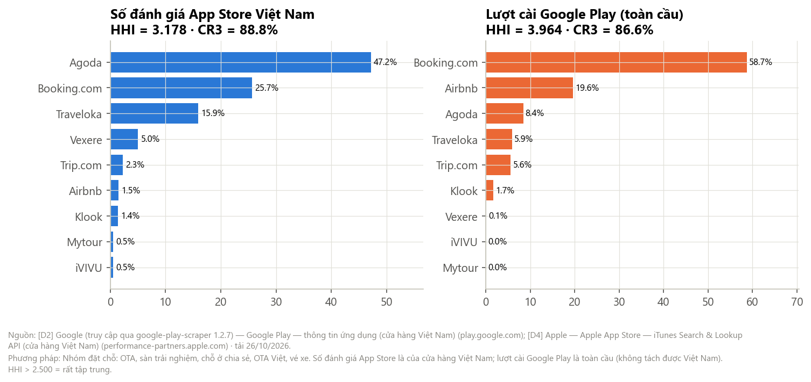
*Nguồn: [D4] số đánh giá ở App Store Việt Nam; [D2] lượt cài Google Play (toàn cầu).*

| Nhóm đặt chỗ | HHI | CR3 | Thị phần (tính từ nguồn) |
|---|---|---|---|
| Số đánh giá App Store **Việt Nam** [D4] | **3.178** | **88,8%** | Agoda 47,2 · Booking.com 25,7 · Traveloka 15,9 · Vexere 5,0 · Trip.com 2,3 · Airbnb 1,5 · Klook 1,4 · iVIVU 0,5 · Mytour 0,5 |
| Lượt cài Google Play (toàn cầu) [D2] | 3.964 | 86,6% | Booking 58,7 · Airbnb 19,6 · Agoda 8,4 · Traveloka 5,9 · Trip.com 5,6 · Klook 1,7 |

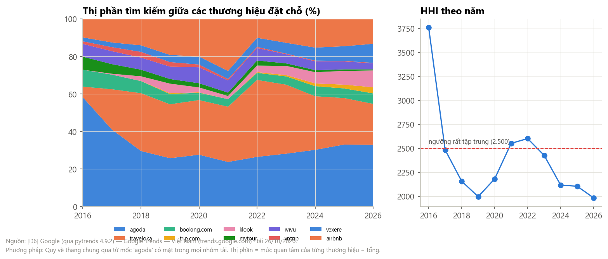
*Nguồn: [D6] Google Trends — thương hiệu đặt chỗ, quy về thang chung qua từ mốc "agoda".*

- Thị phần tìm kiếm 2019 → 2025 [D6]: Agoda 25,7 → **32,9%**, Traveloka 28,8 → 24,8%, Airbnb 19,2 → 14,6%, Vexere 3,8 → **7,8%**, Klook 5,1 → 7,3%, iVIVU 6,6 → 4,2%, Mytour 2,4 → 0,8%, Vntrip 2,4 → 0,3%.
- HHI tìm kiếm: 1.996 (2019) → 2.601 (2022) → 2.104 (2025) — tập trung vừa, đang giảm nhẹ khi Vexere, Klook lên.
- **Thứ hạng gần như cố định:** tương quan hạng giữa hai năm liền nhau 0,86–1,0 (trung bình 0,96).

**→ Rút ra:** mảng đặt chỗ là "sân của ba người" và thứ hạng hiếm khi đổi. Levart làm **đối tác giới thiệu**, không làm đối thủ. Agoda đứng đầu cả số đánh giá ở Việt Nam lẫn sự chú ý — đối tác affiliate đầu tiên hợp lý nhất (tính từ [D4][D6]).

### A3. Cạnh tranh hiện tại — bản đồ định vị và khoảng trống

> **Chuỗi truy vết:** mô tả app [D2][D4] → `analyze_competition.py::feature_matrix` → `results/b2_feature_matrix.csv`, `b2_positioning.csv`, `b2_pca_loadings.csv`

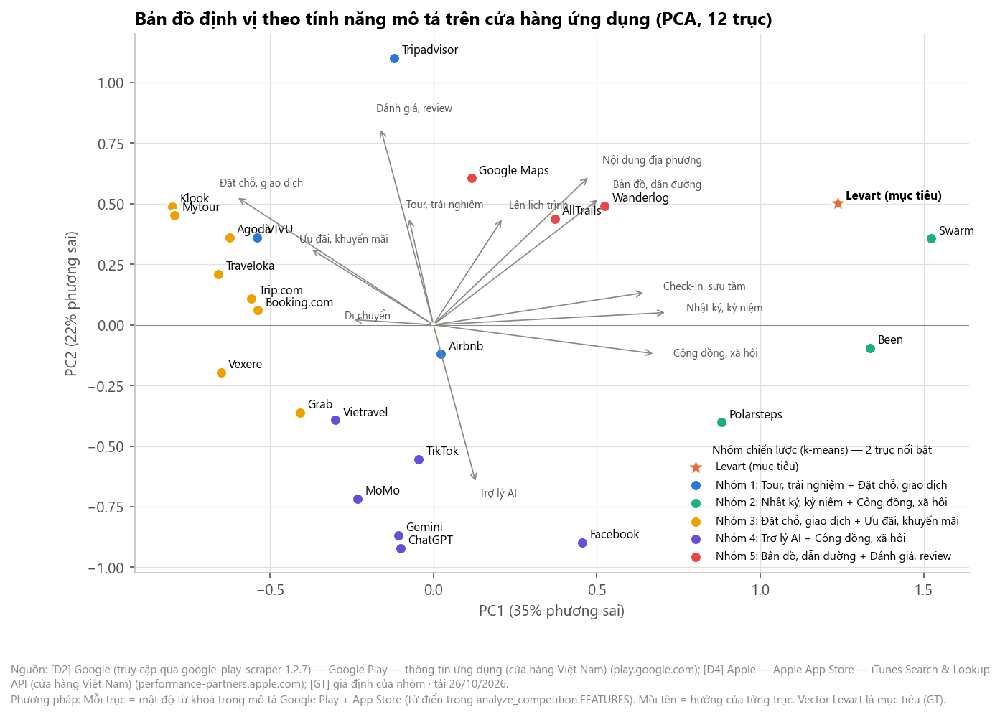
*Nguồn: [D2][D4] mô tả trên cửa hàng; từ điển tính năng và vector Levart là [GT].*

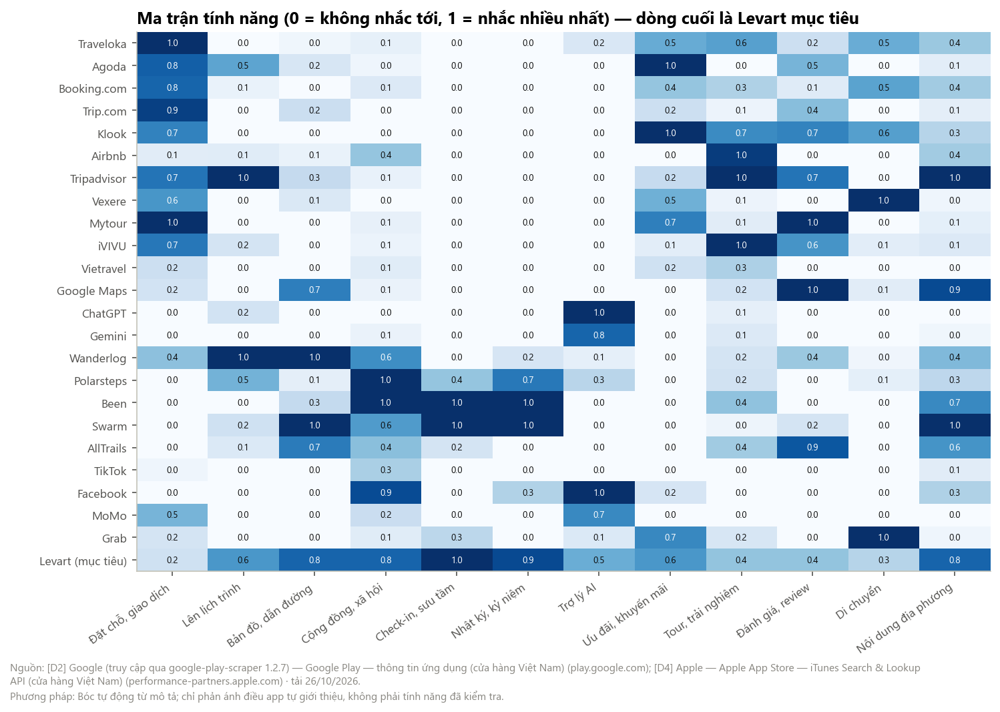
*Nguồn: [D2][D4].*

- PCA trên 12 trục: PC1 giải thích 34,9%, PC2 22,3%, PC3 12,2% phương sai. **PC1** tách "đặt chỗ, ưu đãi" (âm) khỏi "check-in, nhật ký, cộng đồng" (dương).
- **5 nhóm chiến lược** (k-means, tính từ [D2][D4]):

| Nhóm (2 trục nổi bật) | Thành viên |
|---|---|
| Đặt chỗ + ưu đãi | Traveloka, Agoda, Booking.com, Trip.com, Klook, Vexere, Mytour, Grab |
| Tour, trải nghiệm + đặt chỗ | Airbnb, Tripadvisor, iVIVU |
| Bản đồ + đánh giá | Google Maps, Wanderlog, AllTrails |
| Trợ lý AI + cộng đồng | ChatGPT, Gemini, TikTok, Facebook, MoMo, Vietravel |
| **Nhật ký, kỷ niệm + cộng đồng** | **Polarsteps, Been, Swarm** |

- **Levart gần nhất với nhóm cuối:** cosine với Swarm 0,88, Been 0,83, Polarsteps 0,81. Khoảng cách tới app gần nhất bằng **1,42 lần** khoảng cách láng giềng trung vị giữa các đối thủ → Levart đứng ở vùng thưa.
- Nhóm này gần như **vắng ở Việt Nam**: số đánh giá App Store VN là Swarm 34, Polarsteps 91, Wanderlog 280 [D4].

**→ Rút ra:** khoảng trống có thật về *định vị* (tính năng) và về *thị trường* (chưa ai có người dùng ở Việt Nam). Nhưng nó **chưa chứng minh có cầu**. Sự vắng mặt của nhóm này ở Việt Nam có thể vì người Việt chưa cần — phải kiểm bằng phỏng vấn R9.

### A4. Đối thủ mới gia nhập — vào dễ, lớn khó

> **Chuỗi truy vết:** [D2] 671 app, [D4] 4.499 app → `analyze_competition.py::entrants` → `summary.json › b3_entrants`

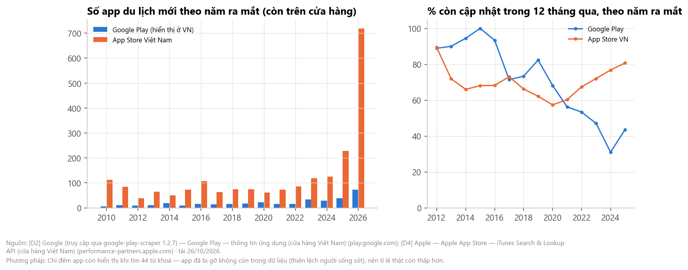
*Nguồn: [D2][D4]. Chỉ đếm app còn trên cửa hàng (thiên lệch người sống sót).*

| App du lịch mới theo năm ra mắt [D4] | 2019 | 2020 | 2021 | 2022 | 2023 | 2024 | 2025 | 2026 (10 tháng) |
|---|---|---|---|---|---|---|---|---|
| App Store Việt Nam | 74 | 61 | 73 | 86 | 118 | 125 | **228** | 719 |
| Google Play (mẫu 44 từ khoá) | 17 | 22 | 16 | 15 | 34 | 29 | 39 | 73 |

- **Tốc độ gia nhập tăng mạnh từ 2023** — trùng thời điểm công cụ AI giúp viết app rẻ đi. 25,9% số app du lịch hiện có trên App Store VN ra mắt từ 2022 trở lại đây [D4].
- **% còn cập nhật trong 12 tháng**, theo năm ra mắt (Google Play): 2019: 82% · 2021: 56% · 2023: 47% · **2024: 31%**. Nhiều app mới bị bỏ trong 1–2 năm [D2].

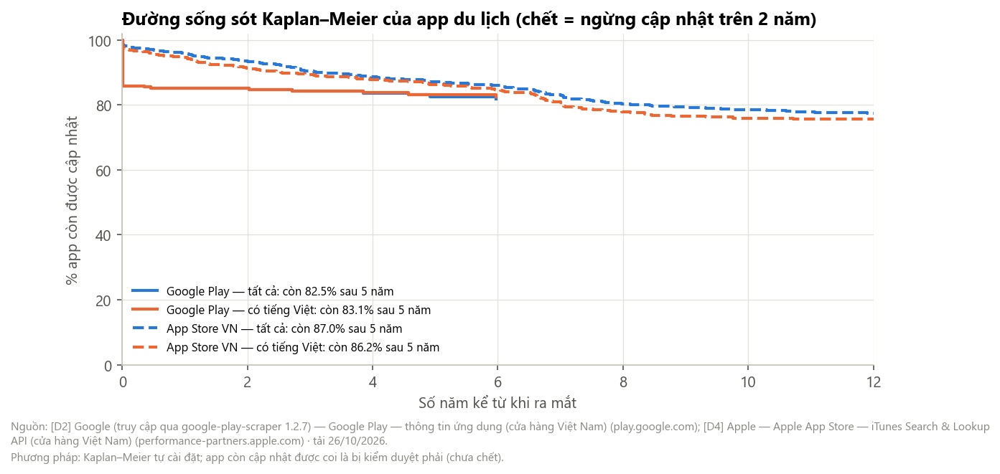
*Nguồn: [D2][D4]. Kaplan–Meier tự cài đặt.*

- Sau 5 năm còn cập nhật: Google Play 82,5%, App Store VN 87,0%; sau 10 năm: 81,9% và 78,5%. App có mô tả tiếng Việt trên App Store còn 75,9% sau 10 năm. Tỉ lệ "chết" theo năm ra mắt trên App Store cao nhất ở lớp 2020: 37,7% [D4].
- *Lưu ý:* app đã bị gỡ không còn trong dữ liệu, nên tỉ lệ sống thật **thấp hơn** con số trên.

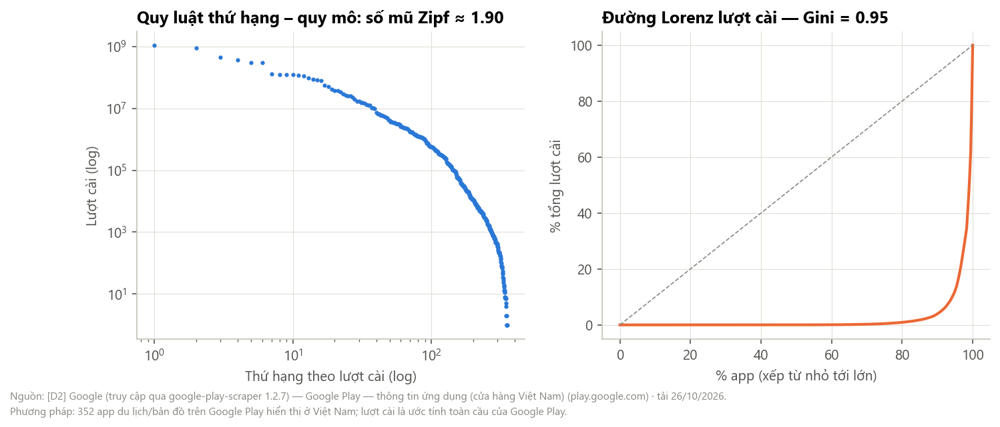
*Nguồn: [D2].*

- **Gini lượt cài = 0,954**; 1% app lớn nhất giữ 46,8% lượt cài, 10% giữ 96%; luật thứ hạng – quy mô với số mũ ≈ 1,9 [D2].
- Trong **190** app du lịch ra mắt từ 2022: chỉ **12,6%** đạt 100.000 lượt cài, **3,7%** đạt 1 triệu.

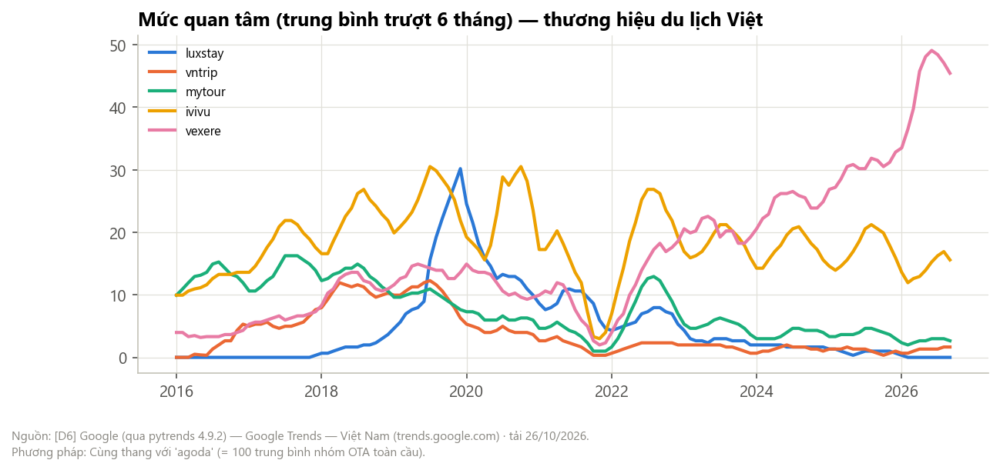
*Nguồn: [D6].*

| Thương hiệu Việt (Google Trends) [D6] | Đỉnh quan tâm | Hiện nay so với đỉnh |
|---|---|---|
| Luxstay | 12/2019 | **0%** — đã biến mất (khớp tin gỡ khỏi Google Play 10/2024) |
| Vntrip | 7/2019 | 13,5% |
| Mytour | 7/2017 | 16,3% |
| iVIVU | 7/2019 | 51,1% |
| Vexere | 6/2026 | 92,6% — người Việt duy nhất đang lên |

**→ Rút ra:** rào cản *gia nhập* rất thấp, rào cản *lớn lên* rất cao — thị trường kiểu "người thắng lấy gần hết". Với Levart: (1) đừng lo bị sao chép ý tưởng, hãy lo **không được ai biết tới**; (2) Vexere là bằng chứng một nền tảng Việt vẫn thắng được khi đi vào ngách mà OTA ngoại không làm (vé xe khách).

### A5. Quyền lực người dùng — đánh giá trên cửa hàng

> **Chuỗi truy vết:** [D3] `play_reviews_*.json` (8.579) + [D5] `itunes_rss_*.json` (6.904) → `analyze_buyers.py` → `results/b4_review_examples.csv`, `b4_cross_mentions.csv`, `summary.json › b4_buyers`

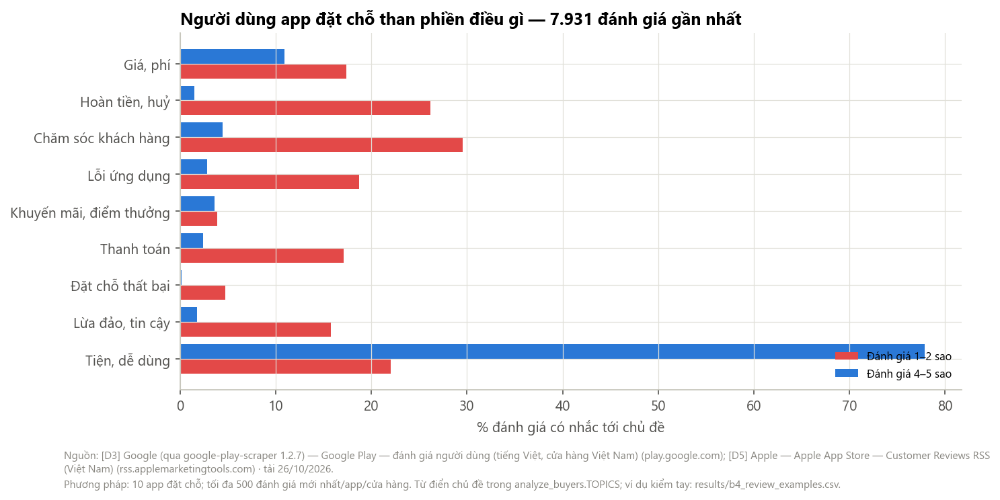
*Nguồn: [D3][D5] — 7.931 đánh giá của 10 app đặt chỗ.*

| Chủ đề (tính từ [D3][D5]) | % ở đánh giá 1–2 sao | % ở 4–5 sao | Hệ số nâng |
|---|---|---|---|
| Chăm sóc khách hàng | 29,5 | 4,4 | ×6,7 |
| Hoàn tiền, huỷ | 26,1 | 1,5 | ×17,4 |
| Lỗi ứng dụng | 18,7 | 2,8 | ×6,7 |
| Giá, phí | 17,4 | 10,9 | ×1,6 |
| Thanh toán | 17,1 | 2,4 | ×7,2 |
| Lừa đảo, tin cậy | 15,8 | 1,8 | ×8,8 |
| Đặt chỗ thất bại | 4,7 | 0,2 | ×26,0 |

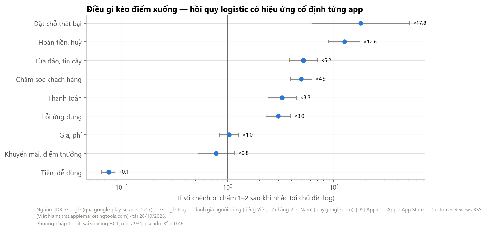
*Nguồn: [D3][D5]. Logit, n = 7.931, pseudo-R² = 0,48.*

- **Tỉ số chênh bị chấm 1–2 sao** (đã kiểm soát từng app và cửa hàng): đặt chỗ thất bại ×17,8 · hoàn tiền, huỷ **×12,6** · lừa đảo, tin cậy ×5,2 · chăm sóc khách hàng ×4,9 · thanh toán ×3,3 · lỗi app ×3,0 · **giá, phí ×1,04 (p = 0,71 — không có ý nghĩa)**.

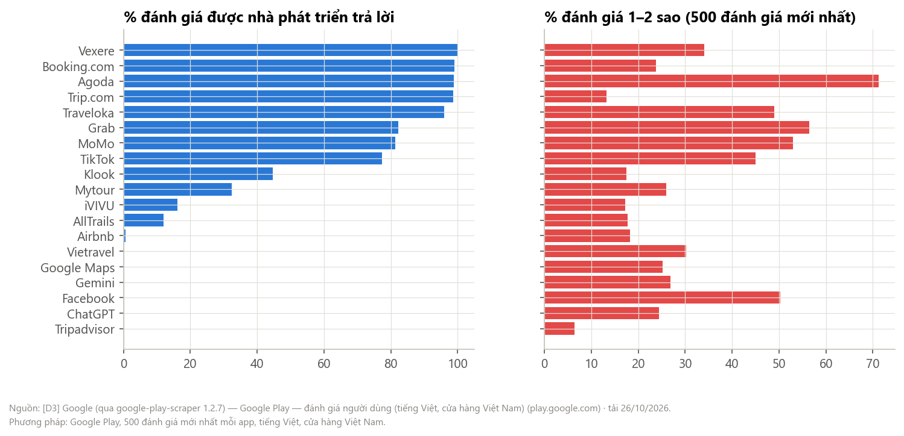
*Nguồn: [D3].*

- **OTA phải chiều người dùng:** tỉ lệ trả lời đánh giá — Vexere 100%, Booking.com 99%, Agoda 98,8%, Trip.com 98,6%, Traveloka 96%. Google Maps, ChatGPT, Facebook: 0% [D3].
- **Điểm gần đây thấp hơn nhiều điểm tổng:** 500 đánh giá mới nhất của Agoda trung bình 2,13 sao, 71% là 1–2 sao (điểm tổng 4,4); Traveloka 2,95 [D3]. Người có vấn đề mới viết đánh giá — đánh giá là *công cụ mặc cả* của người dùng.
- Chỉ **0,8%** đánh giá nhắc tên app đặt chỗ khác; 1,7% nhắc chuyện bỏ app (3,1% trong số 1–2 sao). Người dùng không viết nhiều về việc so sánh — họ âm thầm đổi.

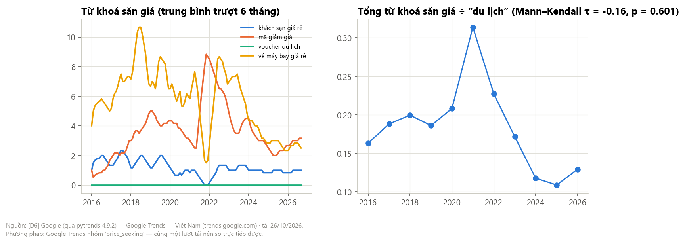
*Nguồn: [D6].*

- Tỉ lệ từ khoá săn giá ("mã giảm giá", "khách sạn giá rẻ", "vé máy bay giá rẻ", "voucher du lịch") so với "du lịch": đỉnh 0,31 năm 2021, còn 0,11 năm 2025 — không có xu hướng có ý nghĩa thống kê (Mann–Kendall τ = −0,16, p = 0,60) [D6].
- Kết hợp R1: độ co giãn tham gia ở chuyến 4–5 triệu ≈ −1,7 [D8].

**→ Rút ra:** quyền lực người dùng **Cao**. Nó thể hiện qua *đánh giá công khai và việc bỏ đi*, không qua ép giá. Với Levart, lỗi đắt nhất là **lỗi ở đối tác** (không có phòng, không hoàn tiền) — phải có cơ chế bảo đảm ngay từ thử nghiệm, và trả lời 100% đánh giá như các OTA.

### A6. Sản phẩm thay thế

> **Chuỗi truy vết:** [D2][D4] đối thủ cốt lõi + [D6] nhóm "substitutes" → `analyze_competition.py::substitutes` → `summary.json › b6_substitutes`

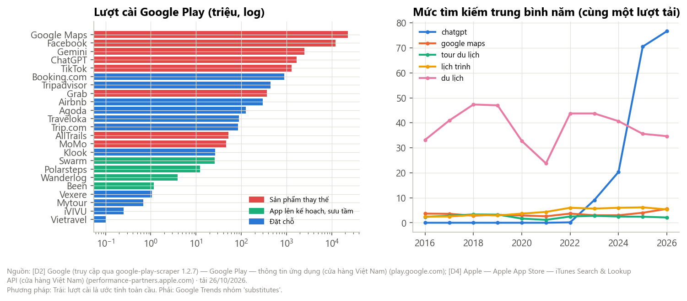
*Nguồn: [D2] lượt cài; [D6] Google Trends.*

| Nhóm (23 app cốt lõi) | Lượt cài Google Play (triệu) [D2] | Số đánh giá App Store VN [D4] |
|---|---|---|
| Sản phẩm thay thế (Google Maps, ChatGPT, Gemini, TikTok, Facebook, MoMo, Grab, AllTrails) | 40.747 | 16.994.526 |
| Đặt chỗ | 1.961 | 278.320 |
| Lên kế hoạch, sưu tầm (Wanderlog, Polarsteps, Been, Swarm) | 43,4 | 405 |

- Tỉ lệ lượt cài thay thế ÷ lên kế hoạch, sưu tầm: **~938 lần** (tính từ [D2]).
- Mức tìm "chatgpt" so với "lịch trình" năm 2025: **11,4 lần**; "google maps" tăng từ 3,0 (2023) lên 5,6 (2026). "Tour du lịch" giảm **25,6%** so với 2019 — sản phẩm thay thế truyền thống đang yếu đi [D6].

**→ Rút ra:** mọi tính năng "giúp lên kế hoạch" đều đã có bản thay thế miễn phí khổng lồ. Nhóm "nhật ký, check-in" thì nhỏ tới mức gần như không tồn tại ở Việt Nam → đó vừa là khoảng trống vừa là câu hỏi về cầu.

### A7. Nhà cung cấp dịch vụ địa phương

> **Chuỗi truy vết:** [D7] `osm_provinces.json`, `osm_lodging_*.json` → `analyze_suppliers.py::lodging` → `results/b5_lodging_by_province.csv` · tham số [S1][S2][GT] → `analyze_suppliers.py::bargaining`

**Phạm vi.** PLAN_RESEARCH 4.3 kê 10 nhóm nhà cung cấp dịch vụ địa phương: chỗ ở, ăn uống, nhà xe, di chuyển tại chỗ, người dẫn – trải nghiệm, mạo hiểm, hàng hoá – quà, hậu cần nhỏ, an toàn (chỉ thông tin), cộng đồng – tổ chức.

| Nhóm | Đo bằng dữ liệu ở R2? | Cách đánh giá trong báo cáo này |
|---|---|---|
| 1 Chỗ ở | **Có** — OSM [D7] + Airbtics [S1] | Cơ cấu cung theo tỉnh (dưới đây) + mô hình thương lượng Nash |
| 3 Nhà xe | Gián tiếp — Vexere trong [D3][D4][D6] | Vexere chiếm 5,0% đánh giá nhóm đặt chỗ, mức tìm kiếm tăng 3,8 → 7,8 (2019→2025): nhà xe đã có kênh số riêng |
| 2, 4–8, 10 | Chưa (OSM phủ rất thưa: quán ăn, thuê xe, người dẫn hầu như không có thẻ) | Giữ nhận định tại bàn (tệp 05), mức C/D; kiểm chứng ở R4 phỏng vấn đối tác |
| 9 An toàn | Không áp dụng | Chỉ là thông tin, không có quan hệ thương lượng |

**Cơ cấu cung chỗ ở theo tỉnh (OpenStreetMap, đủ 34/34 tỉnh mới)** [D7]

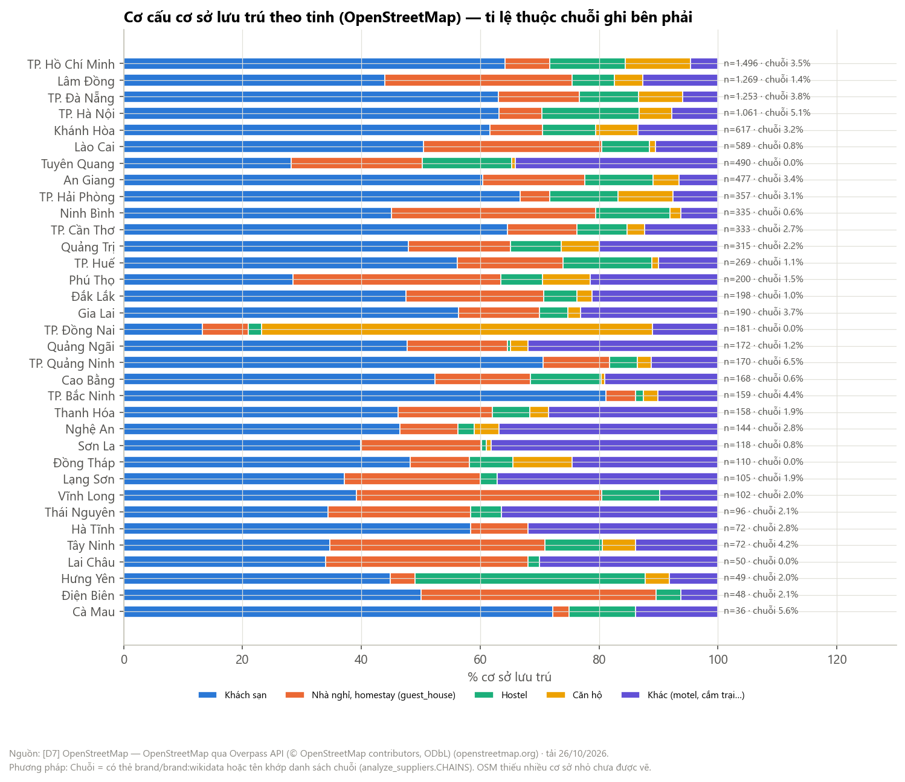
*Nguồn: [D7] OpenStreetMap qua Overpass API (© OpenStreetMap contributors, ODbL), tải 26–27/10/2026. Chuỗi = có thẻ `brand`/`brand:wikidata` hoặc tên khớp danh sách chuỗi trong `analyze_suppliers.CHAINS`.*

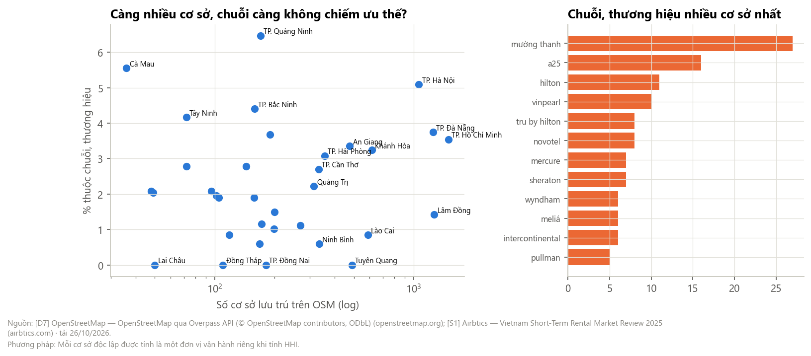
*Nguồn: [D7]. Mỗi cơ sở độc lập là một đơn vị vận hành khi tính HHI. Nhãn tỉnh chỉ ghi cho tỉnh có ≥ 300 cơ sở hoặc tỉ lệ chuỗi ≥ 4% hoặc = 0%.*

| Chỉ báo (toàn quốc) | Giá trị | Ý nghĩa với quyền lực nhà cung cấp |
|---|---|---|
| Số cơ sở lưu trú trên OSM | **11.459** ở 34 tỉnh | Mẫu đủ lớn để so sánh giữa các tỉnh (không phải tổng số thật) |
| % thuộc chuỗi, thương hiệu | **2,63%** | Gần như toàn bộ là cơ sở độc lập |
| % loại nhỏ (nhà nghỉ, homestay, hostel, motel, cắm trại) | **39,7%** (trung vị theo tỉnh 47,8%) | Bên cung nhỏ, ít vốn |
| % có dấu hiệu hiện diện số (điện thoại, web, Facebook gắn trên OSM) | **16,7%** | Phần lớn chưa tự có kênh bán số → cần trung gian |
| HHI theo đơn vị vận hành | **0,96** (trên thang 10.000) | Phân mảnh gần tuyệt đối |
| Chỉ số phân mảnh 1 − HHI/10.000 | **0,9999** toàn quốc; thấp nhất 0,971 (Cà Mau, chỉ 36 cơ sở) | Không tỉnh nào có bên cung tập trung |

- **Tỉnh có chuỗi nhiều nhất** cũng chỉ ở mức một con số: Quảng Ninh 6,5% (170 cơ sở), Cà Mau 5,6% (36), Hà Nội 5,1% (1.061), Bắc Ninh 4,4%, Tây Ninh 4,2%.
- **Tỉnh độc lập nhất** (không có cơ sở thuộc chuỗi, loại nhỏ chiếm đa số): Tuyên Quang (gồm Hà Giang cũ) 0% chuỗi, 71,2% loại nhỏ · Lai Châu 0% / 66,0% · Thái Nguyên 2,1% / 65,6% · Phú Thọ 1,5% / 63,5% · Lạng Sơn 1,9% / 62,9% · Sơn La 0,8% / 59,3% · Ninh Bình 0,6% / 53,1% · Lào Cai 0,8% / 48,6%.
- **Chuỗi xuất hiện nhiều nhất:** Mường Thanh 27 cơ sở, A25 16, Hilton 11, Vinpearl 10, Tru by Hilton 8, Novotel 8. Không chuỗi nào vượt 0,25% tổng số cơ sở.
- **Quy mô tỉnh không quyết định mức độ chuỗi hoá:** Spearman giữa số cơ sở và % chuỗi ρ = 0,05 (p = 0,77). Nhưng tỉnh càng nhiều loại nhỏ thì càng ít chuỗi: ρ = −0,53 (p = 0,001) (tính từ [D7]).
- **Hiện diện số thấp nhất** ở Nghệ An 3,5%, Đồng Nai 5,5%, Lai Châu 6,0%, Hưng Yên 6,1%, Sơn La 6,8%. Cao nhất ở Đà Nẵng 24,6%, Vĩnh Long 22,5%, Ninh Bình 22,4%, Hà Nội 22,2%.
- **Lưu ý dữ liệu:**
  - Bắc Ninh và Lạng Sơn: truy vấn theo vùng (area) của Overpass trả 0 phần tử, có lẽ vì ranh giới tỉnh mới chưa được dựng vùng. Đã lấy bằng cách dự phòng: tải hình ranh giới → truy vấn khung bao → giữ điểm nằm trong đa giác (`fetch_data._lodging_by_polygon`): Bắc Ninh 222 → 159 cơ sở, Lạng Sơn 141 → 105.
  - Đồng Nai: 66% cơ sở gắn thẻ "căn hộ", nhiều tên không phải chỗ ở ("TH …", "khu vui chơi …"). Nhiều khả năng là gắn thẻ sai trên OSM; chỉ số chuỗi và phân mảnh không bị ảnh hưởng, nhưng cơ cấu loại hình của Đồng Nai không đáng tin.

**→ Rút ra (chỗ ở):** bên cung phân mảnh gần tuyệt đối, phần lớn chưa có kênh số. Không chủ cơ sở nào đủ lớn để ép một nền tảng, nên quyền lực nhà cung cấp là **thấp**. Rủi ro thật nằm ở chiều ngược lại: cơ sở nhỏ khó bảo đảm chất lượng ổn định — đúng điều người dùng phạt nặng nhất ở A5 (đặt chỗ thất bại ×17,8). Các tỉnh vùng cao phía Bắc (Tuyên Quang, Lai Châu, Sơn La, Lào Cai, Phú Thọ) vừa độc lập nhất vừa ít hiện diện số: đó là nơi Levart có sức thương lượng cao nhất *và* mang lại giá trị rõ nhất cho đối tác.

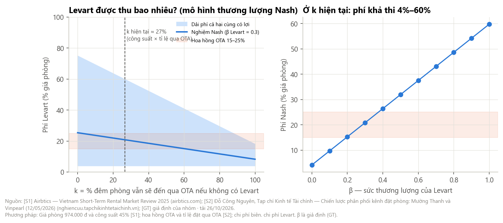
*Nguồn: [S1] giá phòng, công suất; [S2] hoa hồng, tỉ lệ đặt qua OTA; [GT] chi phí biên 25%, chi phí kéo khách 40.000 đ, β.*

**Mô hình thương lượng Nash** (mỗi đêm phòng Levart mang tới):
- Phương án ngoài của homestay: với xác suất *k*, đêm phòng đó vẫn đến qua OTA với hoa hồng 18%.
- Ước *k* = công suất 45,3% × tỉ lệ đặt qua OTA 58,85% ≈ **26,7%** [S1][S2].
- **Sàn phí** (Levart hoà vốn): 4,1% · **trần phí** (homestay không thiệt): **59,8%** · **nghiệm Nash** ở β = 0,3: **20,8%** giá phòng.
- Theo sức thương lượng β: 0 → 4,1% · 0,1 → 9,7% · 0,2 → 15,2% · 0,3 → 20,8% · 0,5 → 32,0%.

**→ Rút ra:** vì phần lớn phòng đang trống, một đêm Levart mang tới gần như là *khách thêm* → homestay sẵn lòng trả nhiều. Lúc đầu Levart yếu (β thấp), nên mức **8–12%** vừa có lợi cho cả hai vừa rẻ hơn OTA (15–25%). **Điểm then chốt:** ở tỉnh đông khách (công suất cao) trần phí sụt mạnh — chọn tỉnh có công suất thấp (Mai Châu, Pù Luông theo R1 A8) là chọn nơi Levart có sức thương lượng.

**Nhà cung cấp công nghệ** (Google Play, Maps, Firebase, Gemini): phí kho ứng dụng 15% [S6]; Maps đổi cách tính phí từ 01/03/2025 [S7]; không thay ngay được → điểm sức ép 3,0 (đánh giá [GT], xem A8).

### A8. Tổng hợp — chỉ số 5 lực

> **Chuỗi truy vết:** `results/summary.json` (B1–B6) + `R1_PESTLE/results/summary.json` → `analyze_synthesis.py` → `results/b7_force_indicators.csv`, `summary.json › f_synthesis`

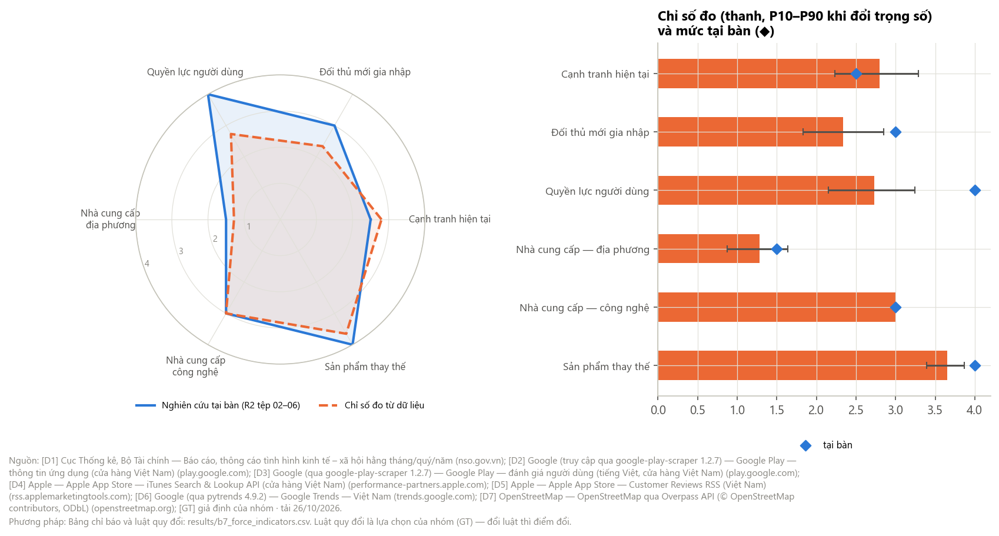
*Nguồn: tổng hợp [D1]–[D8]; luật quy đổi là [GT].*

**Chỉ số sức ép từng lực (0 = không có sức ép, 4 = rất mạnh)** — điểm = trung bình các chỉ báo đã quy về 0–4; P10–P90 lấy từ 20.000 bộ trọng số Dirichlet (α = 2) cho các chỉ báo trong mỗi lực.

| Lực | Điểm | P10–P90 | Mức | Tại bàn (tệp 07) |
|---|---|---|---|---|
| Sản phẩm thay thế | **3,65** | 3,39–3,87 | Rất cao | 4 · Rất cao |
| Nhà cung cấp — công nghệ | **3,00** | 3,00–3,00 | Cao | 3 · Cao |
| Cạnh tranh hiện tại | **2,80** | 2,23–3,29 | Cao | 2,5 · Cao |
| Quyền lực người dùng | **2,73** | 2,15–3,24 | Cao | 4 · Rất cao |
| Đối thủ mới gia nhập | **2,34** | 1,83–2,85 | Trung bình | 3 · Cao |
| Nhà cung cấp — địa phương | **1,28** | 0,87–1,64 | Thấp–trung bình | 1,5 · Thấp–trung bình |

*Ngưỡng mức: ≥ 3,25 Rất cao · ≥ 2,5 Cao · ≥ 1,75 Trung bình · ≥ 1 Thấp–trung bình · < 1 Thấp.*

**20 chỉ báo và luật quy đổi** (`results/b7_force_indicators.csv`)

| Lực | Chỉ báo | Giá trị | Luật quy đổi | Điểm | Nguồn |
|---|---|---|---|---|---|
| Cạnh tranh hiện tại | Độ trùng tính năng lớn nhất với Levart (cosine) | 0,88 | 4 × cosine | 3,50 | [D2][D4] |
| Cạnh tranh hiện tại | HHI nhóm đặt chỗ (App Store VN) | 3.178 | HHI ÷ 1.000 | 3,18 | [D4] |
| Cạnh tranh hiện tại | Độ ổn định thứ hạng (Spearman giữa các năm) | 0,96 | 4 × ρ | 3,82 | [D6] |
| Cạnh tranh hiện tại | Tăng trưởng thực của ngành 2023–2025 (%/năm) | 9,9 | 4 − tăng trưởng ÷ 3 | 0,70 | [D1] |
| Đối thủ mới | % app du lịch iOS ra mắt từ 2022 | 25,9 | % ÷ 10 | 2,59 | [D4] |
| Đối thủ mới | Phí đăng ký phát hành (USD) | 25 | ≤ 100 USD → 4 | 4,00 | [S6] |
| Đối thủ mới | % app mới đạt ≥ 100.000 lượt cài | 12,6 | 4 × % ÷ 25 | 2,02 | [D2] |
| Đối thủ mới | Gini lượt cài | 0,954 | 16 × (1 − Gini), tối đa 4 | 0,74 | [D2] |
| Người dùng | % đánh giá app đặt chỗ nhắc tên đối thủ | 0,8 | % ÷ 5 × 4 | 0,64 | [D3][D5] |
| Người dùng | Tỉ lệ trả lời đánh giá, trung bình 8 app đặt chỗ | 0,73 | 4 × tỉ lệ | 2,93 | [D3] |
| Người dùng | \|Độ co giãn\| tham gia ở chuyến 4–5 triệu (R1) | 1,68 | 4 × \|e\| ÷ 2 | 3,36 | [D8] |
| Người dùng | Có sản phẩm thay thế miễn phí | có | có → 4 | 4,00 | [D2] |
| NCC địa phương | Công suất phòng | 45,3% | 4 × công suất ÷ 0,9 | 2,01 | [S1] |
| NCC địa phương | Phí tối đa homestay vẫn có lợi (f_max) | 59,8% | 4 × (1 − f_max) | 1,61 | [S1][S2][GT] |
| NCC địa phương | % cơ sở lưu trú thuộc chuỗi (OSM, 34 tỉnh) | 2,63% | 4 × % ÷ 50 | 0,21 | [D7] |
| NCC công nghệ | Số nhà cung cấp then chốt không thay ngay được | 4 | số ÷ 4 × 3 | 3,00 | [S6][S7][GT] |
| NCC công nghệ | Phí kho ứng dụng (%) | 15 | % ÷ 5 | 3,00 | [S6] |
| Thay thế | Lượt cài thay thế ÷ app lên kế hoạch, sưu tầm | 938 lần | 4 × log10 ÷ 3 | 3,96 | [D2] |
| Thay thế | Tìm "chatgpt" ÷ tìm "lịch trình" (2025) | 11,4 lần | 4 × log10 | 4,00 | [D6] |
| Thay thế | Thay đổi tìm "tour du lịch" 2019→2025 | −25,6% | 4 × (1 + % ÷ 100) | 2,98 | [D6] |

*Luật quy đổi là lựa chọn của nhóm [GT]. Đổi luật hoặc trọng số thì điểm đổi; khoảng P10–P90 cho biết kết luận vững tới đâu. Thứ tự "thay thế > công nghệ ≈ cạnh tranh ≈ người dùng > đối thủ mới > nhà cung cấp địa phương" giữ nguyên ở phần lớn bộ trọng số. Riêng cạnh tranh, người dùng và đối thủ mới có khoảng chồng nhau, nên không nên xếp hạng cứng giữa ba lực này.*

**Đối chiếu với nghiên cứu tại bàn (R2 tệp 07):**
- **Khớp mức** ở 4/6 lực: thay thế (Rất cao), công nghệ (Cao), cạnh tranh (Cao), nhà cung cấp địa phương (Thấp–trung bình; 1,28 so với 1,5 — dữ liệu OSM còn kéo điểm xuống thấp hơn nhận định tại bàn).
- **Người dùng thấp hơn** tại bàn (2,73 so với 4): dữ liệu cho thấy người dùng hiếm khi nhắc so sánh trong đánh giá (0,8%). Nhưng OTA vẫn phải trả lời gần như mọi đánh giá → quyền lực thể hiện bằng *bỏ đi*, không bằng *ép giá*.
- **Đối thủ mới thấp hơn** (2,34 so với 3): vào dễ, nhưng 87% app mới không đạt 100.000 lượt cài → mối đe doạ thật đến từ **người lớn mở thêm tính năng** (siêu ứng dụng, OTA thêm AI), không phải từ startup.

Trong dashboard ⑧ có thể bật/tắt từng chỉ báo, đổi trọng số để xem kết luận đổi tới đâu.

---

## PHẦN D – MÔ PHỎNG (trong dashboard)

| Mô phỏng | Câu hỏi | Tham số mặc định và nguồn |
|---|---|---|
| ② Bản đồ định vị | Đổi vector tính năng của Levart thì gần ai, xa ai? | 12 trục [D2][D4]; vector Levart [GT] |
| ③ HHI khi Levart vào | Levart giành x% nhóm đặt chỗ thì độ tập trung đổi ra sao? | thị phần App Store VN [D4] |
| ③ Khuếch tán Bass | Người dùng Hà Nội 20–29 tuổi sau 3 năm? Rời bỏ quan trọng tới đâu? | m = 10% × 1,34 triệu [D8][GT]; p = 0,01; q = 0,35; rời bỏ 20%/quý [GT] |
| ⑤ Logit đánh giá | Một đánh giá nhắc chủ đề X có khả năng bị 1–2 sao bao nhiêu? | hệ số hồi quy [D3][D5] |
| ⑥ Thương lượng Nash | Levart thu được bao nhiêu % giá phòng? | [S1][S2][GT] |
| ⑧ Chỉ số 5 lực | Bỏ hoặc đổi trọng số chỉ báo thì lực nào đổi hạng? | 20 chỉ báo |

---

## PHẦN E – HẠN CHẾ

| Nguồn | Hạn chế | Ảnh hưởng tới |
|---|---|---|
| [D1] | Web chỉ đăng mức doanh thu ở một số kỳ; nhiều kỳ chỉ có tốc độ tăng. Bóc tự động bằng biểu thức chính quy — đã kiểm tay các kỳ năm, nhưng có thể sót | A1 |
| [D2] | Lượt cài là toàn cầu, không tách Việt Nam; vũ trụ app từ 44 từ khoá × 30 kết quả nghiêng về app phổ biến; Google tự dịch mô tả nên không dùng được làm dấu hiệu "app Việt" | A2–A4, A6 |
| [D4] | Số đánh giá ≠ số người dùng (tỉ lệ viết đánh giá khác nhau giữa app) | A2, A6 |
| [D3][D5] | Đánh giá mới nhất nghiêng về người có vấn đề; từ điển chủ đề bỏ sót cách viết khác | A5 |
| [D6] | Chỉ số tương đối; tên thương hiệu trùng từ thông dụng ("booking") | A2, A4 |
| [D7] | OSM thiếu nhiều cơ sở nhỏ (11.459 trên OSM, ít hơn nhiều so với thực tế); thương hiệu nhận diện bằng thẻ brand và danh sách tên; Bắc Ninh, Lạng Sơn lấy bằng lọc đa giác; thẻ loại hình ở Đồng Nai có dấu hiệu gắn sai; quán ăn, thuê xe, người dẫn hầu như không có trên OSM | A7 |
| Mô hình Nash, chỉ số 5 lực | Nhiều tham số [GT]; luật quy đổi chỉ báo do nhóm đặt | A7, A8 |
| Thiên lệch người sống sót | App đã bị gỡ không có trong dữ liệu → tỉ lệ sống thật thấp hơn | A4 |

---

## PHẦN F – CÁCH CHẠY LẠI

```bash
cd data_inspect/R2_Nganh_5luc/tools
pip install pandas numpy scipy statsmodels matplotlib plotly scikit-learn requests pytrends google-play-scraper
python run_all.py            # dùng dữ liệu đã cache
python run_all.py --fetch    # tải lại nguồn còn thiếu
python sources.py            # cập nhật _MANIFEST.csv và SOURCES.md
```

- Mã app của 23 đối thủ được kiểm tay (26/10/2026) trong `fetch_data.CORE`.
- Overpass hay quá tải — tải lại riêng: `python fetch_data.py osm_lodging` (tỉnh đã có dùng cache; tỉnh trả 0 phần tử tự chuyển sang lọc đa giác).
- Lỗi `numpy.dtype size changed` khi import pandas nghĩa là numpy ≥ 2 đang đi cùng pandas 2.2.1. Chạy trong môi trường ảo có `numpy==1.26.4` (bản đã dùng để ra kết quả này), hoặc nâng pandas lên ≥ 2.2.3. Trên Windows nên đặt môi trường ảo ở đường dẫn ngắn, vì tên tệp DLL của OpenBLAS dễ vượt giới hạn 260 ký tự.

---

## PHẦN G – CẬP NHẬT CHO 7 TỆP R2 (01_Nghien-cuu/R2_Nganh_5-luc)

| Tệp | Nhận định tại bàn | Dữ liệu nói gì | Nguồn mới | Đổi mức |
|---|---|---|---|---|
| 01 Tổng quan | Ngành tăng ~8%/năm | GTTT thực lưu trú–ăn uống 2025 = 128,8% mức 2019; +9,9%/năm 2023–2025 | [D1] | C → A |
| 02 Cạnh tranh | 3 OTA ngoại ~80% | Trên App Store VN, 3 hãng đầu 88,8%, HHI 3.178; thứ hạng gần như cố định | [D4][D6] | C → B |
| 02 Cạnh tranh | Mảng sưu tầm còn trống (D) | Nhóm Swarm, Polarsteps, Been gần Levart nhất nhưng < 400 đánh giá ở VN | [D2][D4] | D → B |
| 03 Đối thủ mới | Mối đe doạ Cao | Trung bình (2,34): vào dễ nhưng chỉ 12,6% app mới đạt 100.000 lượt cài | [D2][D4] | D → B |
| 04 Người dùng | Rất cao | Cao (2,73): phạt bằng đánh giá khi dịch vụ hỏng (×12,6); giá không phải lý do | [D3][D5] | C → B |
| 05 Nhà cung cấp | Thấp–trung bình | Thấp–trung bình (1,28): 2,63% thuộc chuỗi, phân mảnh 0,9999 ở 34 tỉnh; Nash: dải phí 4–60%, nghiệm ~21% | [D7][S1][S2][GT] | C → B (chỗ ở); nhóm khác giữ C/D |
| 06 Thay thế | Rất cao | Rất cao (3,65): lượt cài gấp ~938 lần app lên kế hoạch | [D2][D6] | C → B |
